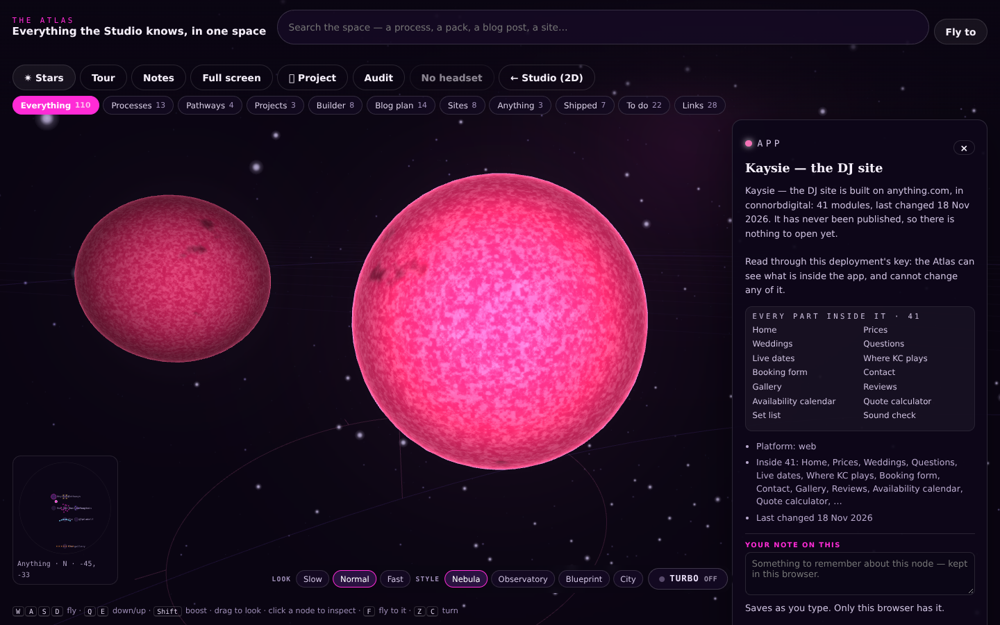
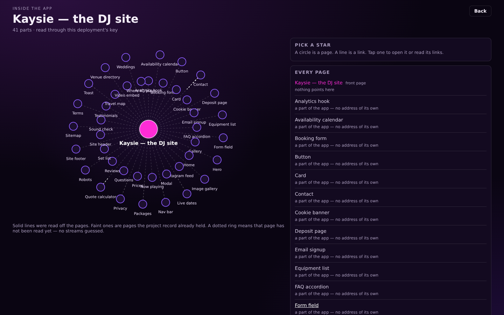
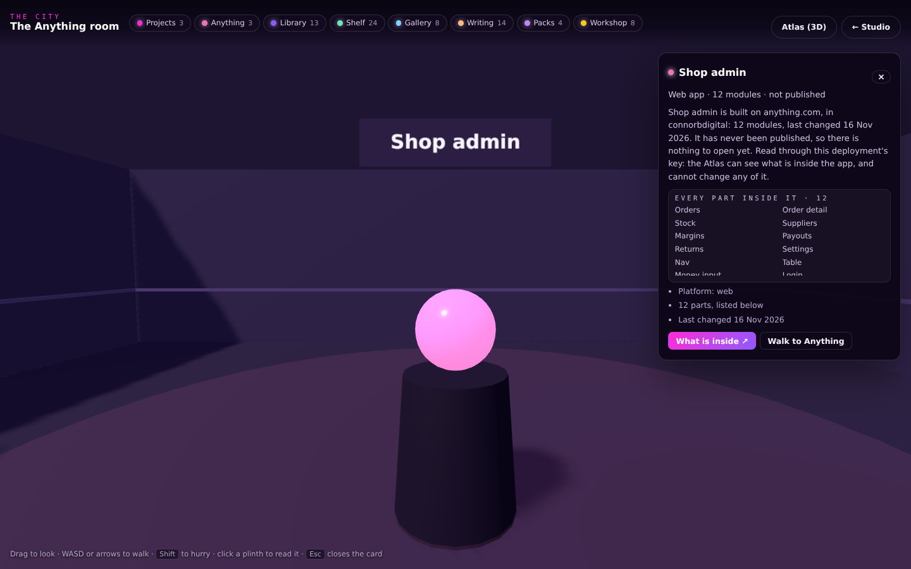
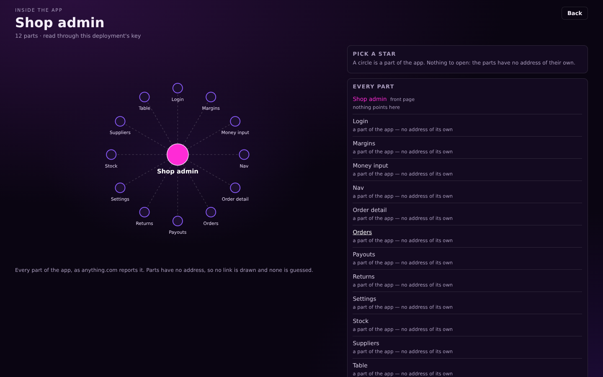
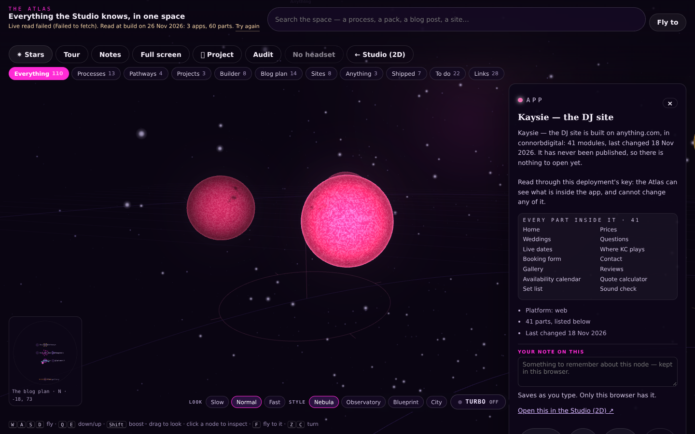
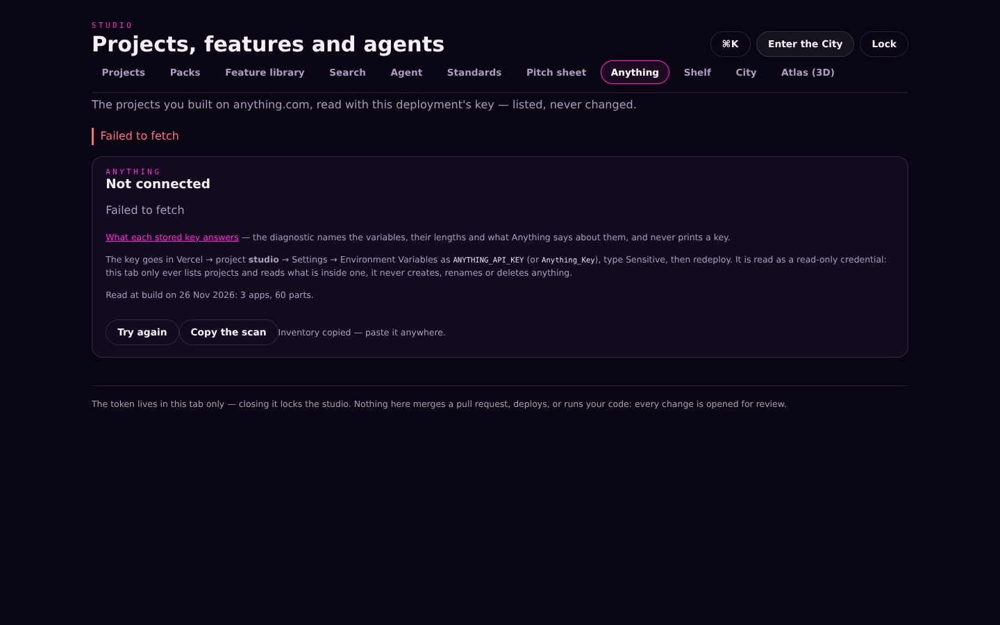

# Every Anything project, every part of it, in both spaces

*2026-11-20. The spaces were showing a summary of each app. Now they show the app.*

## What was actually wrong

Two caps, both invisible:

| Where | The cap | What it did |
| --- | --- | --- |
| `anythingClient.toApp` | `files.slice(0, 24)` | an app with 41 parts was drawn as a 24-part app |
| `loadAnythingApps` | `limit: 8` (Atlas asked for 12) | an account with 12 apps had 8 suns in the space |

And one collapse, fixed in the previous round: `buildSpace` named a page after its
address, and a module has none, so every module in an app became `page` and
deduplicated into a single star. That is why an app's room looked empty.

So the scan is now the whole account: **every project** (24 detail calls at most,
which is the point where a first paint stops being worth it) and **every part**
inside it (400 is a guard against a pathological response, not a display choice).
`moduleCount` keeps the number the project actually reported, so a capped list
can say it is capped rather than lying quietly.

## The Atlas

Selecting an app sun now shows **EVERY PART INSIDE IT · 41** as a scrolling grid,
not the first twelve names in a bullet. The bullet says `41 parts, listed below`;
the list is the list.



**What is inside ↗** opens the app's own space, and it is the app this time:

- the kicker reads *Inside the app*, and the meta line reads
  `41 parts · read through this deployment's key` — no invented page counts, no
  "0 links read" for things that have no links;
- forty-one parts sit on **two rings** (radius alternates 0.54 / 0.84), because one
  ring of forty-one labels is a word cloud, not a map;
- every part says `a part of the app — no address of its own`, so nothing pretends
  a component is a page that could be opened;
- the footer says no stream was drawn, and why: parts have no address, so no link
  could be read off them and none was guessed.



Apps fill a ring of eight, then a second ring eleven units further out: ten suns on
one circle is a crowd, and a ring you cannot count is not a map.

## The City

The Anything room holds **one plinth per app** — up to 24, which is what a room
that size can fit with a metre between plinths (`MAX_OBJECTS` went 16 → 24, and
the room fills six across rather than four, because it is wider than it is deep).
Walking to a plinth reads the app, and the card carries **EVERY PART INSIDE IT**
as well as **What is inside ↗**.





## The scan moved to the build

The first version of this scanned in the browser: one list call plus one detail
call per project, on every visit, and nothing shown until the last one answered.
That is the wrong place to read an account whose key lives on the server.

`scripts/scan-anything.mts` now runs as part of `npm run build`, where the key
already is, and writes `src/generated/anythingScan.json` — every project, every
part, once per deploy. `src/anythingScan.ts` reads it through `import.meta.glob`,
so a checkout with no scan (a test, a type-check, a fresh clone) still builds and
the spaces say *This build has no Anything scan in it* rather than failing.

The consequences, in order of who benefits:

- **the spaces are full before the first request** — the suns, the plinths and
  their parts are in the bundle;
- **an API outage no longer empties a room** — the Atlas keeps the build's
  inventory and says `Live read failed (…). Read at build on 26 Nov 2026: 3 apps,
  60 parts.`, which is the difference between a degraded page and a blank one;
- **one scan per deploy instead of 26 requests per visitor.**

The scan never fails a build. A missing key, a refused connection or one slow
project becomes `{ ok: false, reason }` in the JSON, and the spaces print the
reason. `ANYTHING_BASE` overrides the API host so the whole path can be proved
against a local mock without a key — which is exactly how it was proved:

```
$ ANYTHING_BASE=http://localhost:4411 ANYTHING_API_KEY=test npm run build
scan:anything — 3 projects, 60 parts → src/generated/anythingScan.json
✓ built in 3.30s

# then, with every /api/anything request aborted in the browser:
atlas  chips "Anything 3" · 41 parts · EVERY PART INSIDE IT · 41
       head: "Live read failed (Failed to fetch). Read at build on 26 Nov 2026: 3 apps, 60 parts. Try again"
city   "Anything 3" · Anything room furnished from the scan
```



## The real account, read for the first time

The next production build printed what no amount of local testing could:

```
scan:anything — 24 projects, 3396 parts → src/generated/anythingScan.json
```

So: the key reaches the build, the API answers, and the account has **24 projects
(capped) and 3,396 parts** — an average of 141 parts per app, which is three times
the old per-app cap of 24 and explains why apps looked thin.

Two consequences, both fixed here:

- **The ring stops labelling past eighty parts.** Every star is still drawn; the
  words are dropped, because a hundred and forty labels on top of each other is
  noise, and the list beside the ring is the index. One app with 141 parts reads
  as a constellation with a lit index, not a word cloud.
- **24 projects is the cap, not the account.** `?limit=100` is asked for; if there
  are more than 24, the extra are absent and the count says 24. Raising it is one
  number, and the next round should raise it now that a build scan costs nothing
  per visitor.

## Getting the real inventory out

The key still cannot be read back, so the deployment offers the next best thing:
**Copy the scan** on the Anything tab puts the build's inventory on the clipboard
as JSON — including it in the *Not connected* panel, because a broken key is
exactly when the last good scan matters most. One click, one paste, no secret.



## How this was checked, and what was not

The sandbox cannot read the Anything key: on Vercel it is a **sensitive** variable,
which by design never returns a value — `get_env_var` answers `"value": null`,
`"decrypted": false`. It also cannot reach `api.anything.com` (the TLS connection
is refused from here). So the scan could not be run against the real account from
this environment, and this document does not claim it was.

What was run instead: the same `/api/anything` contract, mocked on the preview
harness with three apps and **60 parts** — one app with 41, one with 12, one with 7:

```
chips:  Projects 3 | Anything 3 | Library 13 | Shelf 24 | Gallery 8 | Writing 14 | Packs 4 | Workshop 8
atlas:  APP · Kaysie — the DJ site · 41 modules
        EVERY PART INSIDE IT · 41
        inside → 41 parts · read through this deployment's key · 42 stars
city:   The Anything room · card "Shop admin" · EVERY PART INSIDE IT · 12
        What is inside → 12 parts on the ring
tests:  259 passed · tsc clean · no console or page errors
```

On the real deployment the same code reads the real account, because that is where
the key lives — the browser never sees it, and the bridge only forwards `/v0/api/me`,
`/v0/api/projects` and one project's detail.

**What is not verified here:** the real names, the real count, and whether the real
`files` array is what the spaces expect. If the Anything account reports its
components under a different key, the room will say *Nothing read from inside it
yet* rather than invent parts — and that is the honest failure, not a silent one.

## The one-line version

An app in the spaces is no longer a description of an app with a sample of its
parts: it is every part the API will give, listed, counted, and standing on a ring
you can actually read.
