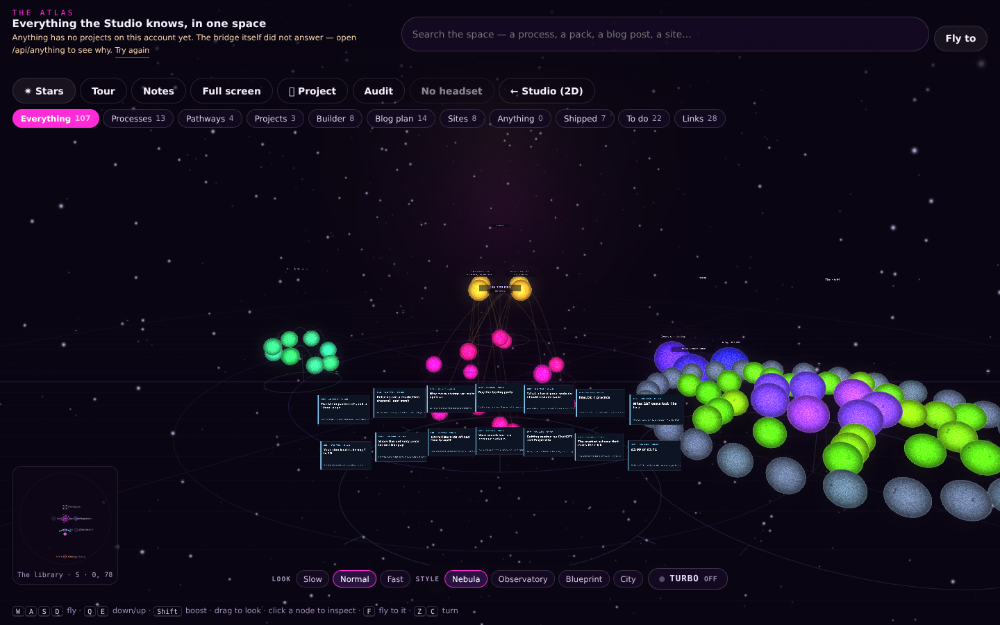
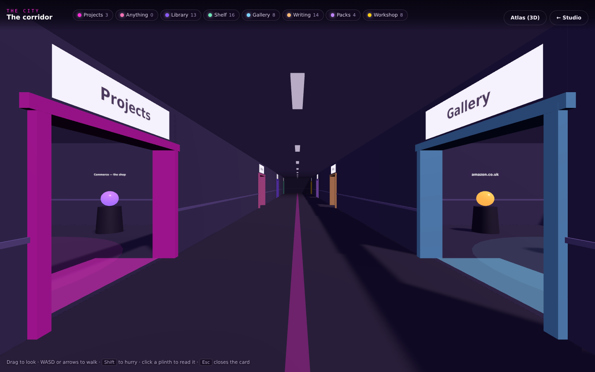
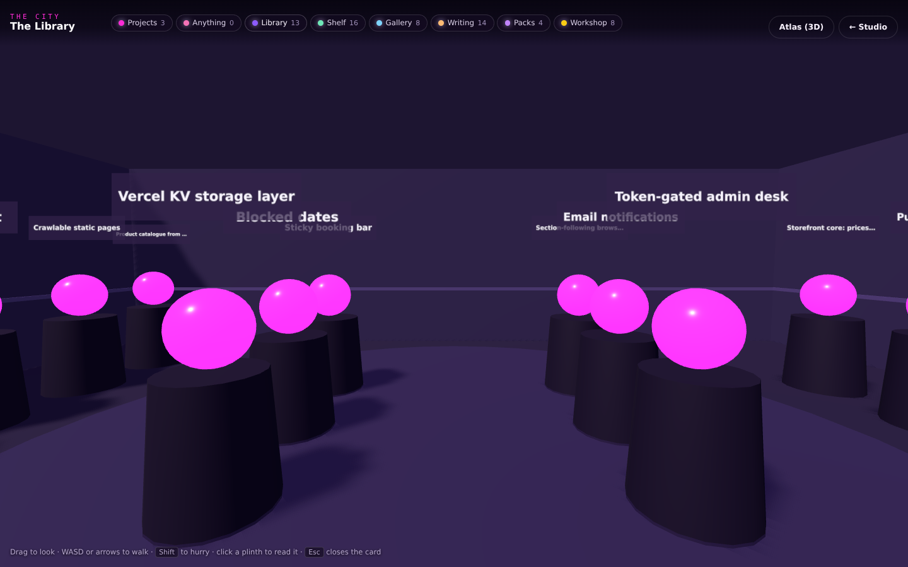
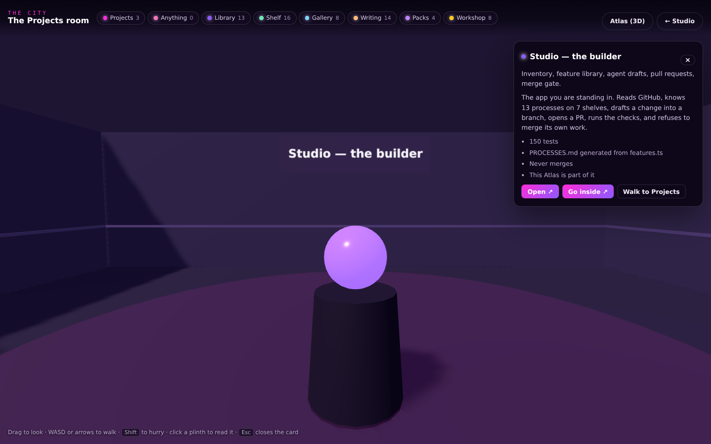
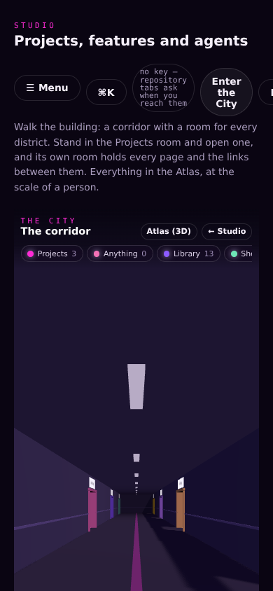

# Two spaces: the Atlas gets its name back, and the City is built

*2026-11-20. The Atlas was never removed — it had been renamed. This is the round
that says so out loud, and then builds the thing the name had been stolen for.*

## What had actually happened

The 3D space was called **Atlas (3D)**. In an earlier round it was relabelled
**The City** and given a paint job of the same name, so the tab, the header button
and the front door all said *City* while the stars, the nebula and the eight
districts underneath were unchanged. Nothing was deleted. It looked deleted
because the label on the door had changed.

That is the correction: **the Atlas keeps its name, its stars and its menu slot.**
And the City becomes what the word promised — a building.

## The Atlas, as it was

- Tab: **Atlas (3D)**, its own slot in *Look around*.
- Look: **Nebula** by default, and the style row still carries City, Observatory
  and Blueprint for anyone who liked the old paint.
- `✷ Stars`, Tour, Notes, Full screen, `＋ Project`, Audit, the VR button, the
  district chips, the search, the minimap, the deep links `#atlas/<node>` — all
  untouched.
- The head still measures itself (`--atlas-head`, 165/184/282/199 px at
  1440/1100/860/390), which is the fix from the previous round and has not
  regressed.

## The City, built

A **corridor 61 m long**, 3.4 m to the ceiling, with strip lights down the middle
and a door on each side for each district:

| Door | Room | What is on the plinths |
| --- | --- | --- |
| Projects | 13 × 9 m | the three projects, each opening its own space |
| Anything | 13 × 9 m | your anything.com apps, each with its modules inside |
| Library | 13 × 9 m | the 13 capabilities |
| Shelf | 13 × 9 m | 16 of 57 — the rest are held back, so the room stays walkable |
| Gallery | 13 × 9 m | the 7 live sites |
| Writing | 13 × 9 m | the 14 blog posts |
| Packs | 13 × 9 m | the 4 packs |
| Workshop | 13 × 9 m | the 8 builder steps |

Each door carries a lit sign on the wall above it (light plate, dark letters, so
it reads down the corridor), and a band of that district's colour runs across the
threshold into the room. Inside, every node is a **plinth** with a glowing orb and
its name above it; click one and the same card the Atlas shows appears — with
**Open ↗** and **Go inside ↗** where they apply — and *Go inside* opens the
project's own space, which is unchanged.

**The building is data, not scenery.** `src/city.ts` holds the rooms, the walls,
the door gaps, the plinth grids and the walking rules, and `src/city.test.ts`
holds it to them:

- no two rooms overlap, and every wall run is on the corridor line;
- the corridor is walkable end to end — a straight line from one end to the other
  stays inside it;
- every doorway is open, and the wall immediately beside it is shut;
- `step` slides along a wall instead of stopping dead, so a corridor with eight
  doors in it is still a corridor;
- no room is filled past 16 objects, and no two plinths are closer than a metre;
- nothing stands where you cannot stand.

**Scale is the point.** The camera is 1.62 m, doors 2.6 m, the ceiling 3.4 m, and
the plinths are waist-high. `Drag` to look, `WASD` or the arrows to walk, `Shift`
to hurry, `Q`/`E` and the wheel for pitch, `Esc` to close a card. On a phone the
left third of the screen is a walk pad, the chip rail scrolls, and portrait gets a
wider vertical field of view so the corridor is not a keyhole.

## The two doors, said plainly

| Where | The Atlas | The City |
| --- | --- | --- |
| The gate | **Enter the Atlas →** | **Walk the City →** |
| The header | the **Atlas (3D)** tab | **Enter the City** button |
| A link | `#atlas`, `#stars`, `#atlas/<node>` | `#city`, `#entrance` |
| A key | not needed | not needed |

Leaving the City by name (`#tab=atlas`, or the **Atlas (3D)** button in its own
bar) now lets go of the space. Before this round the deep-link state was captured
once at boot and never released, so the link worked and the screen did not move.

## Anything apps in the space

The Atlas has put every anything.com app on the Anything arm since the last round,
each carrying its module names. Two things were still wrong:

1. An app's **space** collapsed to a single star. `buildSpace` names a page after
   its address, and a module has no address, so all of them were called `page` and
   deduplicated into one. Identity now falls back to the name: a module gets its
   own star, and it has no link because it has no address. There is a test.
2. Only a *project* offered **Go inside**. An app now offers **What is inside ↗**
   and opens the same ring, one star per module.

## Sites

The Studio is now one of the sites the Atlas knows: `studio-connorbdigital.vercel.app`,
with what it is, what it does, what to look at, and a supply view (gives / wants /
check). Sites is 8.

## What is still not true

- **Nothing new to look at in the Anything room on a fresh deployment.** With no
  `ANYTHING_API_KEY`, the room is a floor and a wall: the chip reads `Anything 0`,
  and the card says why. It fills the moment the key is there.
- **One storey, no furniture.** The building is rooms, walls, doors and plinths.
  There are no windows, no stairs, nothing to read on the walls.
- **The City does not know where you have been.** No minimap, no "you have opened
  4 of 13 in this room", no remembered position — the Atlas remembers its camera;
  the City starts at the door every time.
- **The FPS budget is spent on the CPU.** Many point lights killed the frame rate
  during this round and were replaced with unlit ceilings, emissive orbs and
  translucent floor pools. It holds on a laptop; a low-end phone is untested.
