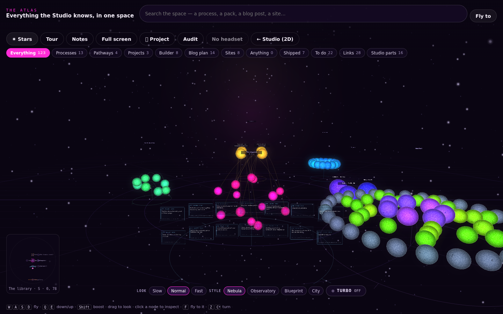
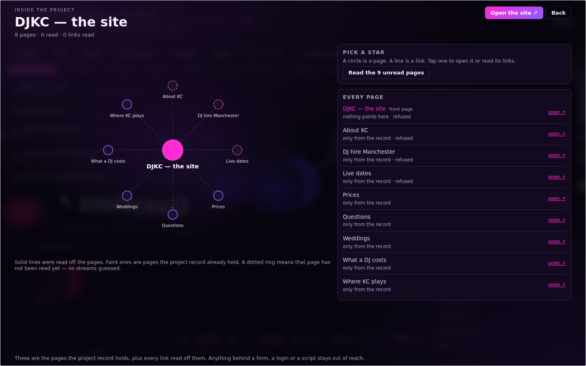
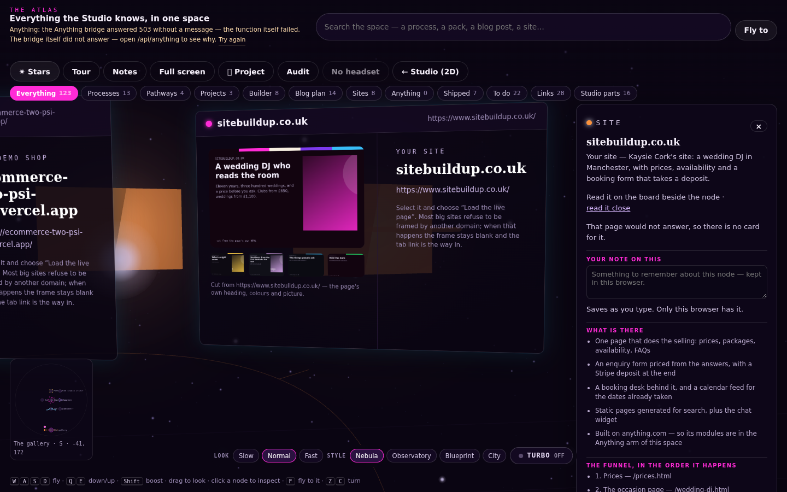

# Holograms, not blocks

*20 November 2026. Why the space had started to look like a wall of slabs, and what was changed.*

## What was wrong

The 14 entries of the blog plan are `brief` nodes, and a brief was drawn as an
**opaque card**: a filled rectangle with `depthTest: false`, so it was painted
over everything else in the frame. Fourteen of those, seen from the library,
added up to a grid of dark slabs floating in front of the stars. The stars
themselves were fine — the briefs had turned into the loudest thing on screen,
and they read as blocks pasted onto the space rather than objects in it.

The gallery panels had a milder version of the same problem. Their backgrounds
were 93% opaque, so a row of eight of them, seen from the south arm, was a fence
between you and the stars.

## What a brief is now

A hologram:

- **Glass instead of paint** — a diagonal fade from a barely-there blue-black to
  almost nothing, drawn over a transparent canvas, so stars show through it.
- **A lit rim** — the kind colour as a 3px stroke with a 28px shadow behind it,
  so the edge is what you notice at a distance, not the fill.
- **In the space, not on the glass** — `depthTest: true`, so a brief behind a star
  is actually behind it. Two holograms no longer punch holes in each other
  because neither writes depth.
- **It wakes as you approach** — opacity runs from 0.1 at 154 units to 1 at 34.
  Far away, a brief is an outline in the dark; fly up to it and the words arrive.
  This is the part that makes the default view read as a sky again.

## What a panel is now

The same idea, applied to the site screens in the gallery:

- background is a translucent gradient with a cyan rim glow instead of
  `#0f0719ee`;
- the head and body are translucent, so the stars behind show through the frame;
- the **plate stays opaque** — deliberately. The frame is glass; the page is a
  page. A translucent picture of a page would be a lie about what it is;
- sized at 0.0114 instead of 0.012, so eight panels no longer touch each other
  at the edges of the row.

## What a project's own space is now

Opening a project star (or an Anything app star) still puts you inside that
project — 9 pages for DJKC, drawn as a hub-and-spoke star map with the links read
off the pages themselves. What changed is that it is now **dark glass over the
space you came from**: the same gradients, at 86% instead of full, with a 7px
backdrop blur, so the stars you were flying among are still faintly there behind
it. The hub carries a pink glow, each page a violet one.

## What this did not change

No node was renamed, moved, repurposed or removed. The Atlas keeps its name, its
stars and its menu slot. The geometry is the same geometry — only the materials
and the distance behaviour changed.

## Files

- `studio/src/atlasEngine.ts` — `cardSprite()` (glass, rim, depth), the per-frame
  opacity fade, and the panel scale.
- `studio/src/styles.css` — `.atlas-panel`, `.atlas-panel-head`, `.atlas-panel-body`,
  `.space`, `.space-node`.

