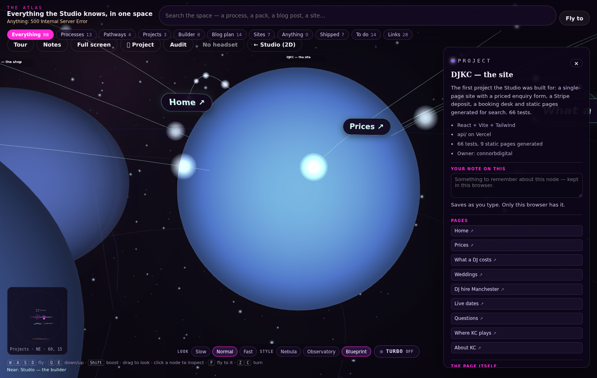
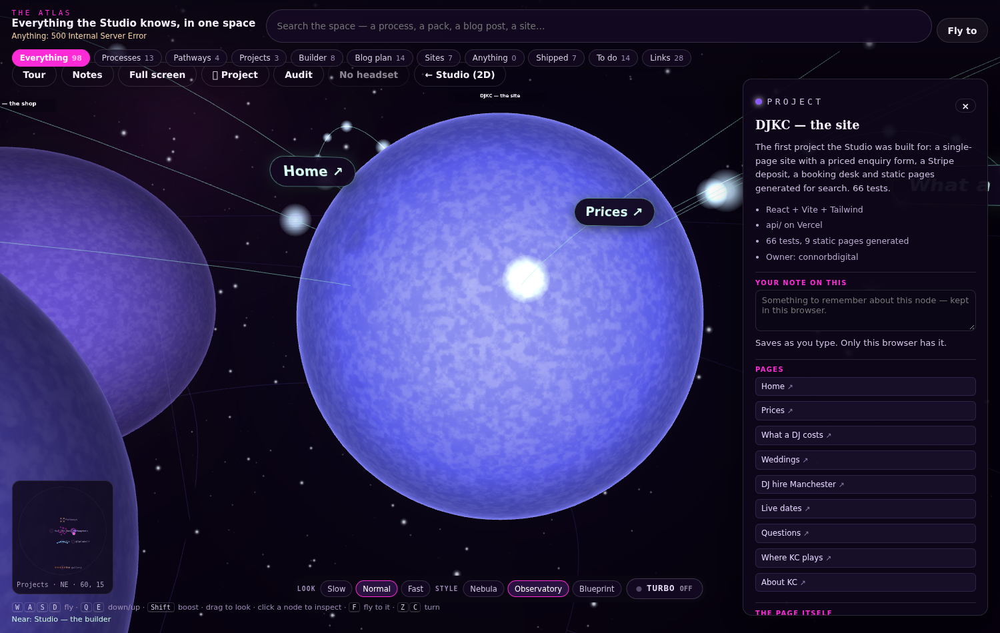
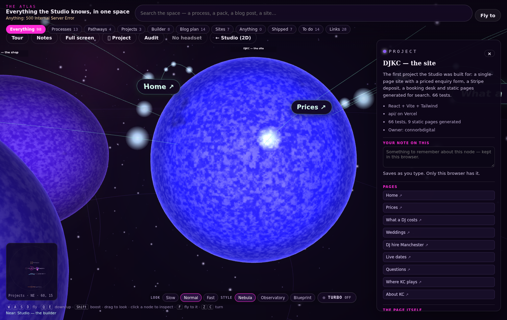

# Three ways the room can look, a turbo you can click, and the 500

*2026-11-20*

## The three looks

The Atlas is the same geometry in every look — same nodes, same wires, same
distances. What changes is the light, the air, and how much the suns are allowed
to bloom. The **Style** chips at the bottom of the screen switch between them, and
the choice is remembered.

| Look | What it is | For |
| --- | --- | --- |
| **Nebula** | Pink and violet, churning granulation, generous coronas | The house look: a place with weather in it |
| **Observatory** | Cold, white stars, tighter glow, flat-ish discs | Reading structure: the shape of the districts |
| **Blueprint** | Flat cyan discs, bright grid, no bloom | Showing someone how the thing is wired |

If one of these is the direction, say so and it becomes the only one — or the
default, with the others kept as a switch.

## Turbo, as a button

There is now a **TURBO** button with an on/off state, in the tray on a desktop and
as the ⚡ key on a phone's thumb pad. Click it: it latches, the button lights, and
the frame pulls open by eight degrees so the extra speed reads as speed. Click it
again to stop. Holding <kbd>Shift</kbd> still works as a burst, and the gamepad
trigger still works.

The latched state survives a reload, along with the look.

## The look was too twitchy

Two things were wrong, and both are fixed:

- **Sensitivity.** A drag turned you at 0.0026 radians per pixel and the right
  stick at 2.4 radians per second, which is a space that spins away from you. Both
  are down by roughly a third, and there is now a **Look: Slow / Normal / Fast**
  control that scales the drag *and* the right stick together, remembered per
  browser. Slow is 0.6×, Fast is 1.7×.
- **The cards were eating clicks.** A CSS3D card near the camera is hit-tested in
  three dimensions, so it sat *above* the HUD in the hit-test order and swallowed
  clicks meant for the tray. The stage now owns its own stacking context, and the
  cards are display-only: the engine raycasts an invisible plane over each card
  and opens the link itself. The anchor stays in the tab order, so a keyboard still
  opens it.

## The 500

`Anything: 500` was the browser repeating a status code with no meaning in it: the
proxy passed an upstream 5xx body straight through, and an HTTP/2 response has no
reason phrase to print next to the number.

The bridge now does three things instead:

1. **Never passes a 5xx through.** A failure comes back as JSON with the upstream's
   own words: `Anything answered 500 on /v0/api/projects: <what it said>.`
2. **Tries the shapes the docs allow** before giving up: the list as asked, then the
   plain list, then `/v0/api/me` — and, for each organization the key can see, the
   list filtered by `organizationId`. A 500 on one shape is not proof that the
   account has no projects.
3. **Says whose key it is.** If `/me` answers, the message ends with
   *"The key itself works — it belongs to … which can see N organizations"*, so a
   broken list and a broken key are different sentences.

Under the title it reads as one sentence with a **Try again** next to it, and the
function itself is wrapped, so a crash in the bridge is a JSON sentence too rather
than an unreadable page.

**What to do with it:** open
<https://studio-connorbdigital.vercel.app/#tab=atlas> and read the line. It now
names the endpoint, what Anything said, and whether the key works. Send me that
sentence and the next fix is aimed rather than guessed — the sandbox I work in
cannot reach `api.anything.com`, so your browser is the only place this can be
seen.

## Checks

- Studio 200 tests, `tsc --noEmit` clean, production build clean.
- Browser, desktop 1500×950: the tray renders and switches all three looks; turbo
  latches, persists and lights the frame; a page card opens its own href; the
  Anything note appears with a working **Try again**.
- Browser, phone 390×844, touch: the tray is gone, the ⚡ pad button latches
  (`aria-pressed="true"`, `is-boosting` on the shell, `atlas:feel` stored), and
  nothing overlaps the sheet or the thumbs.
