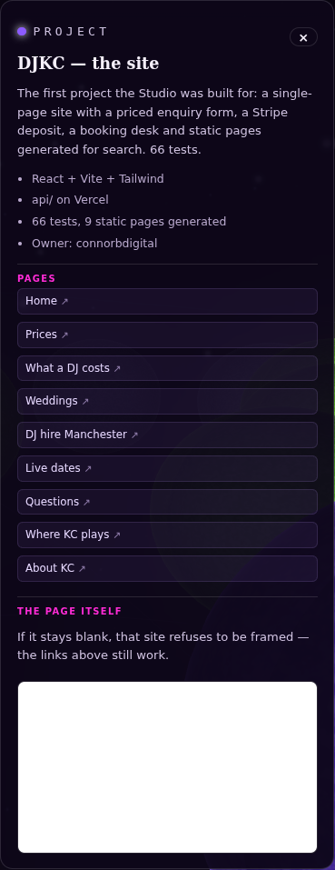
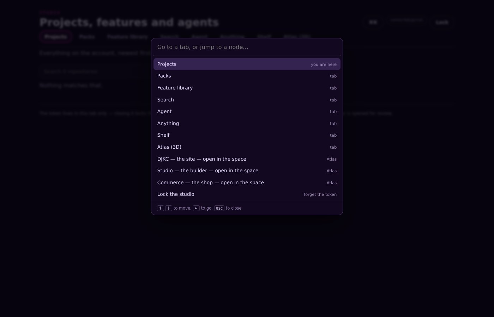

# Projects that open their pages — and ⌘K

*2026-11-20*

Two things landed together: a project in the space now shows **every page it has as
a link**, and there is a **command palette** on ⌘K / Ctrl-K for everything that
already exists.

## What a project shows now

Click a project node — in the space, from the palette, or from a link like
`https://studio-connorbdigital.vercel.app/#atlas/project-djkc` — and the panel has
three parts:

1. **What it is** — the same paragraph and bullets as before.
2. **Pages** — one real link per page, each opening in a new tab.
3. **The page itself** — the project's own site, framed, under the links.

The page lists are data in `studio/src/atlas.ts`, next to the project record:

| Project | Pages |
| --- | --- |
| DJKC — the site | 9: home, prices, what a DJ costs, weddings, DJ hire Manchester, live dates, questions, where KC plays, about |
| Studio — the builder | 8: one per tab, each a `#tab=` link |
| Commerce — the shop | 5: the live shop plus the four repository documents |

The DJKC list is the nine pages `scripts/build-static-pages.mts` actually
generates — a test pins the two lists together, so a page cannot be invented here
or quietly dropped from the build without a red test.

A frame that refuses to be framed (`X-Frame-Options`, `frame-ancestors`) stays
blank; the link above it still works, and the caption says so instead of leaving
a mystery. A page is never framed inside itself: the Studio's own link is the
one case where the frame is skipped.

## Links that mean something

The hash now names where you are, in both directions:

- `#tab=search` opens Search — on a cold load **and** when clicked while the
  studio is already open (`hashchange` is handled).
- `#atlas/<node id>` opens the space with that node selected.
- Leaving the space replaces the node link with `#tab=…`, so the back/forward
  story is not two links fighting over one hash.

## ⌘K

`studio/src/palette.ts` is the matching, `studio/src/components/Palette.tsx` is
the sheet, and the commands are built in `App.tsx` from things that already
exist: the eight tabs, the three projects ("open in the space"), and "Lock the
studio". Twelve commands, no invented actions.

- `⌘K` / `Ctrl-K` toggles it anywhere in the studio; the `⌘K` button in the
  header does the same for a phone with no keyboard.
- Typing scores: label starts with the query (3), a word inside it starts with
  the query (2), letters in order (1), aliases and nothing at all (0).
- `↑` `↓` move, `↵` runs, `esc` closes. The list is scrollable and keyboard-only
  works throughout.

Six tests cover the matching; a browser pass covers the rest: opened by button,
filtered `shelf` → Enter → Shelf tab, `Ctrl-K` → `djkc` → Enter → the space with
the DJKC node open, `esc` closes.

## Still on the shelf

`command-palette` came off the todo list — it is built, so it is no longer a
todo. Twenty remain, six of them the `later` ones from yesterday: notes that sync
across devices (needs a KV store and an env var), pinning a note to a node, a
gamepad, the Studio as an installable app, and preview images for the sites'
links.
