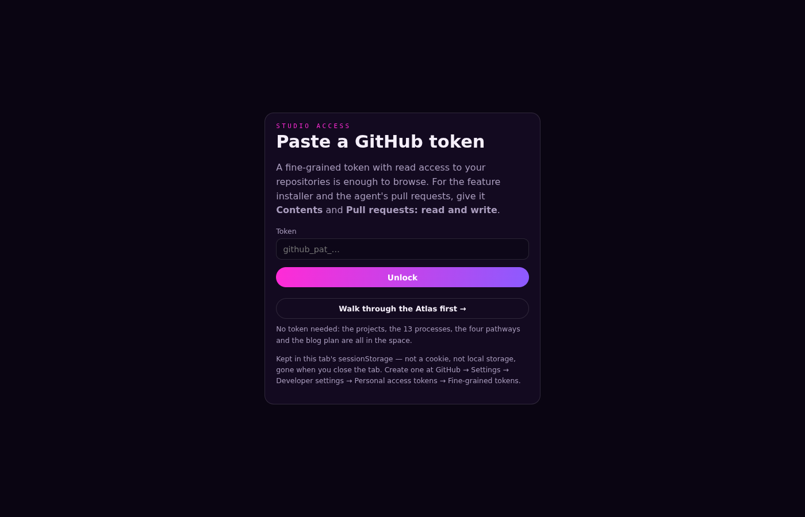
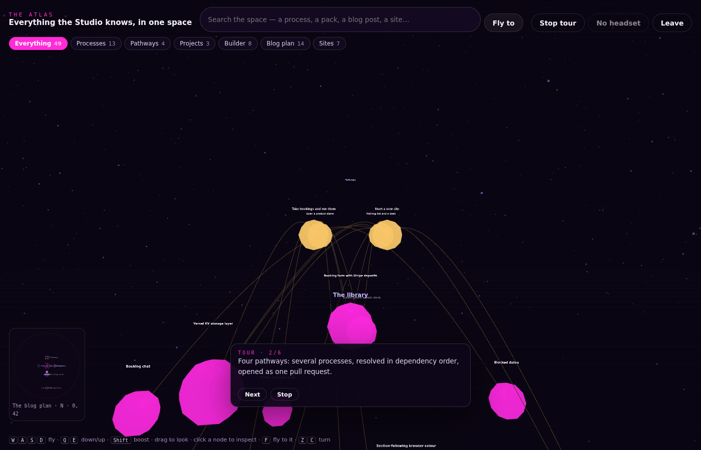
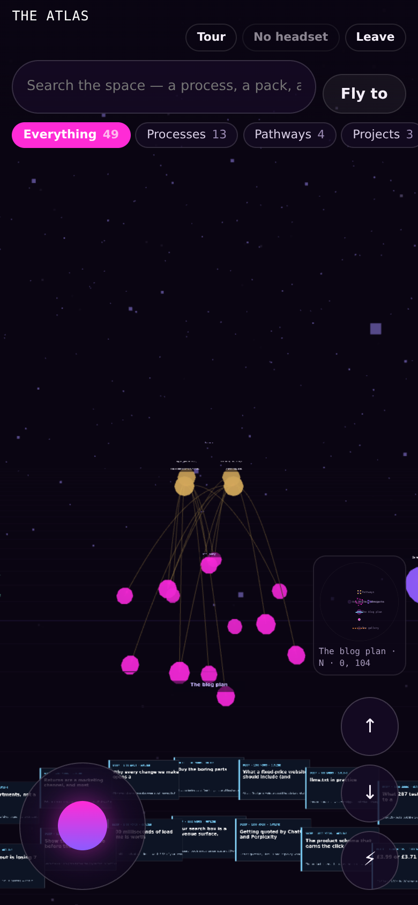
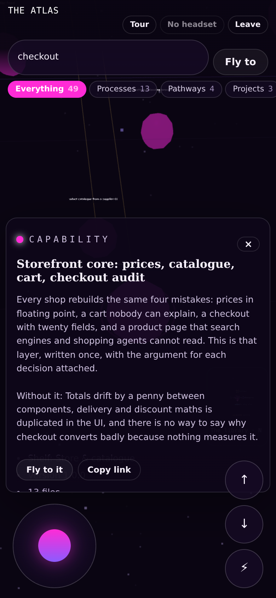
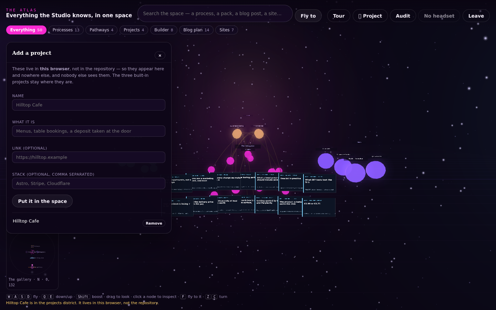
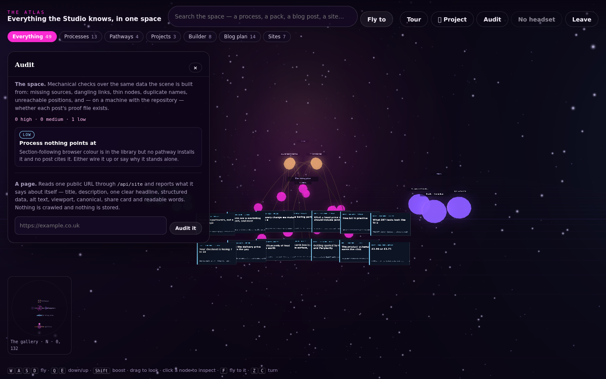
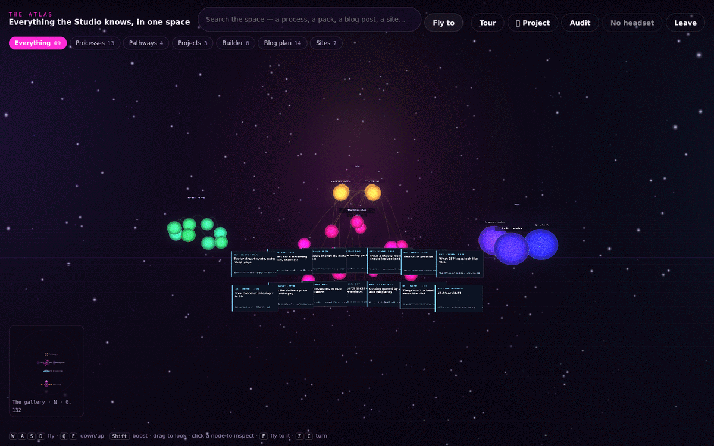
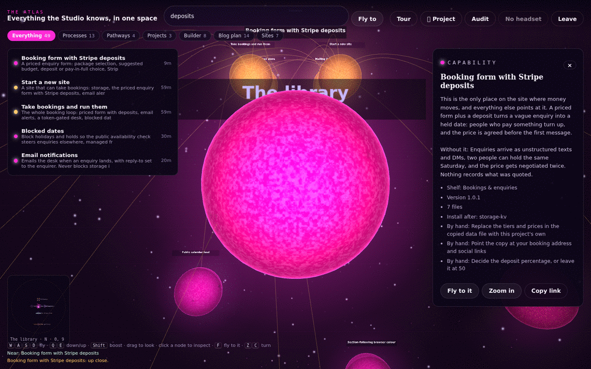
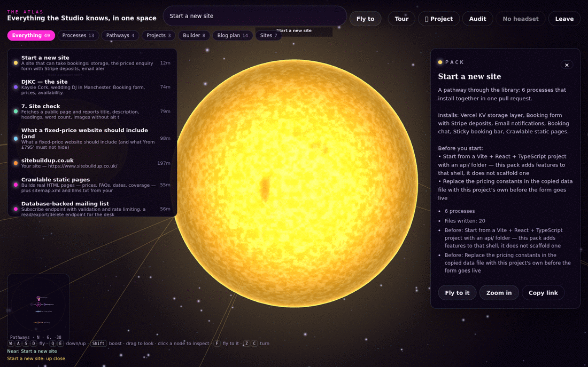
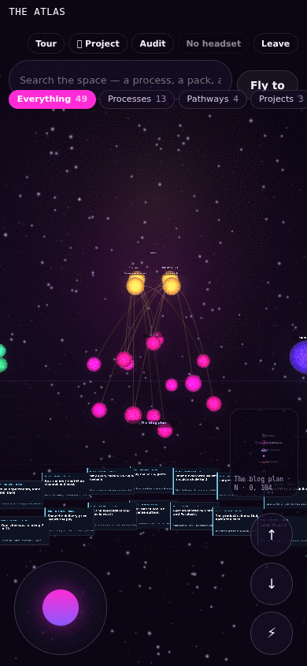

# The Atlas — one space for everything the Studio knows

Built 20 Nov 2026. It lives in the Studio at the **Atlas (3D)** tab, and it opens
without a GitHub token: the gate has a second button, *Walk through the Atlas
first*, because the space is local data, not an API call.



## What is in the space

49 nodes, six districts, laid out as a place rather than a list:

| District | Nodes | What is there |
| --- | --- | --- |
| **The library** | 13 | Every capability the Studio can install, on a golden-angle sphere so no two labels collide |
| **Pathways** | 4 | The packs — whole setups installed as one pull request — hanging above the library, wired to the capabilities they contain |
| **The builder** | 8 | The Studio's own process, step by step, down the left side |
| **The projects** | 3 | This site, the shop, and DJKC — in a ring, sized by what they contain |
| **The blog plan** | 14 | Every post for `sitebuildup.co.uk`, as a two-row wall of cards you can read from across the room |
| **The gallery** | 7 | Live sites as panels in the world |


World coordinates are multiplied by `WORLD_SCALE = 0.62` at the end of
`buildAtlas()`, so the districts are authored at a comfortable spacing and then
compressed for walking speed. The map in the bottom-left corner is the same data
drawn flat, and it tells you which district you are standing in.

## Flying it

| Input | Does |
| --- | --- |
| `W` `A` `S` `D` | Move along the ground plane |
| `Q` / `E` | Down / up |
| `Shift` | Boost (3.2×) |
| Drag | Look |
| Scroll | Dolly forward |
| `Z` / `C` | Turn without the mouse |
| Click a node | Inspect it: the HUD card on the right carries the detail |
| `F` | Fly to the selected node, then look at it |
| District chips | Filter to one kind of thing **and** travel to its district |
| Search box | Search the space — see below |
| `Enter VR` | WebXR, if a headset is attached |

The camera is clamped inside a 300-unit radius and below 160, so you cannot get
lost outside the space. Arriving at a node is a timed flight, not a teleport: the
frame loop eases position and look angles together.

## Search

`searchAtlas()` scores each node field by field:

| Where the word appears | Weight |
| --- | --- |
| The title | 8 |
| The summary line | 5 |
| The bullets | 3 |
| The body | 1.5 |

Whole-word beats substring, so **"affiliate" opens the post about affiliate
commission (£3.99 or £3.71), not the shop that mentions it in its detail**, and
there is a test that says so. Empty or nonsense queries return nothing rather
than noise. `bestMatch()` is the "fly to what the query means" version of the
same thing.

## The blog plan

14 posts, about 19,200 words as briefs, all written for **sitebuildup.co.uk** and
all arguing from a number this repository can show:

- Your checkout is losing 7 in 10 baskets
- Show the delivery price before the pay button
- 100 ms of load time is worth 3.5% of revenue
- The search box is a revenue surface, and 70% of queries fail on it
- Getting quoted by ChatGPT and Perplexity
- The product schema that earns the click
- £3.99 or £3.71: the 28p that decides whether you hold stock
- Twelve departments, not a "shop" page
- Returns are a marketing channel
- Why every change we make opens a pull request first
- Buy the boring parts: four things no small business should build
- What a fixed-price website should include (and what "from £795" must not hide)
- `llms.txt` in practice
- What 287 tests look like to a client who cannot read code

Each brief carries the target query, the audience, the service it sells, an
outline, the facts with **evidence** (a file path, a provider's terms, a test
count), and the capability it demonstrates. `npm run briefs` renders them all to
[`studio/BRIEFS.md`](../studio/BRIEFS.md).


Clicking the card flies to it and opens the brief in the HUD — the promise, the
outline, and every fact with its source.


## The gallery

Seven sites stand in a row at the far end, each a CSS3D panel in the 3D scene.
Select one and choose **Load the live page** to put the real page inside its
frame; **Open** takes you to it in a tab.


Two honest limitations, both visible in the UI rather than hidden:

- **Sites refuse to be framed.** `sitebuildup.co.uk` sends framing headers, so
  the frame stays white and the panel says so, with the tab link. Nothing is
  proxied, scraped or faked, and the note in the panel says that too.
- **Chromium does not hit-test CSS3D content.** Buttons inside the 3D panels
  cannot receive a click, so the panels are display-only and the real controls
  live in the HUD. That is why the engine binds input to the stage element that
  holds both layers, and why a drag that starts on a panel is ignored.

## VR

`enterVR()` asks the browser for an immersive session; if there is none, the
button says **No headset** instead of pretending. In a session the HUD and the
CSS3D panels hide and the controllers teleport you along the ray.

**Not verified on hardware.** The checks in this repository ran in headless
Chromium, which has no WebXR device, so the honest statement is: the fallback is
tested, the session path is guarded and typed, and a headset has not been tried.

## What is checked

- `npx vitest run` in `studio`: **102 passed**, 23 of them about the space — node
  count and uniqueness, every node in a real district, finite coordinates inside
  bounds, edges that resolve, search ranking, briefs that name real capabilities,
  and a floor on how many briefs carry evidence.
- The whole repository: **287 tests** (66 site, 102 studio, 119 commerce).
- `npm run build` in `studio`: 279.63 kB main chunk, and the Atlas as its own
  lazy chunk of 596.62 kB — three.js is only downloaded when someone opens the
  space.
- A browser walk in Chromium: the gate opens the space, the canvas draws, search
  flies to a post, a site's panel loads a live page, the district chips travel,
  `W` moves, and **zero console or page errors**.

## Second pass: phones, and more to do in the space



### What was actually broken on a phone

An audit at 390 × 844 with touch emulation found five real faults, not a
cosmetic one among them:

1. **An old `max-width: 720px` block hid the title and the minimap outright**,
   left over from a previous round and never revisited.
2. **The header wrapped into three rows that overlapped**: the action buttons sat
   on top of the search field and the filter chips cut through both.
3. **There was no way to move.** The space answered `WASD`, `Q`/`E` and `Shift`
   and nothing else, so on a phone you could look around and that was all.
4. **Portrait framing was wrong.** At the desktop 62° vertical FOV, a 390 px wide
   window sees a 31° horizontal slice: the whole atlas became a speck in a tall
   black screen.
5. **The detail card covered the world** and its buttons fell below the fold.

### What the space does now

| Touch | Does |
| --- | --- |
| Thumbstick (bottom left) | Move, in the direction you push |
| Drag anywhere else | Look |
| Pinch | Dolly forward and back |
| Tap a node | Inspect it |
| ↑ / ↓ pads | Rise and drop |
| ⚡ pad | Boost |

- **Portrait gets its own framing**: `responsiveFov()` widens the vertical field
  of view as the aspect narrows (capped at 86°), the start pose becomes an
  angled overview at `(0, 52, 104)` instead of the desktop entrance, and the
  pixel ratio is capped at 1.5 on coarse pointers.
- **The HUD is rebuilt for small screens**: one compact bar, a scrollable chip
  rail, the detail card as a bottom sheet with sticky actions, and a smaller
  minimap with each district tappable.
- **The dock is the instruction manual** — "drag to look, pinch to zoom, tap a
  node" replaces the keyboard legend, which is meaningless on glass.

### And more to do, on both

- **A guided tour**: six stops, one per district, each with a sentence; any input
  hands control straight back.
- **Deep links**: `#atlas/brief-affiliate-vs-resell` opens the space looking at
  that node, and every card has a **Copy link** button.
- **Search you can see**: matched nodes pulse and glow in the world while the
  query is live, not just in the list.
- **A working map**: district dots on the minimap are buttons that fly you there,
  and the dot for where you are standing is drawn larger.
- **Your place is remembered**: the camera position is written to
  `localStorage` every second and restored on return — not on tab close, because
  a page unload does not reliably run React's cleanup.
- **A pointer that knows**: hovering a node changes the cursor and lifts the node
  under it (desktop only).
- **Bounded, everywhere**: the flight clamp now runs in one place, so pinch and
  the thumbstick cannot push you outside the space either.





### Checks

- `npx vitest run` in `studio`: **105 passed** — three new tests cover the FOV
  curve, the deep-link parser and the tour's integrity (every stop a real
  district, every named node real, no district twice).
- `npm run build`: 279.64 kB main chunk, `Atlas` 604.62 kB lazy.
- Chromium at 390 × 844 with touch: gate → space, thumbstick moves the camera,
  a real two-finger pinch dollies it (z 104 → 85), a chip flies to its district,
  a result opens the bottom sheet, the tour captions advance, deep links open,
  and **zero console or page errors**.
- Chromium at 1400 × 900: the desktop layout is unchanged apart from the new
  Tour button and Copy link action.

**Not verified:** a physical iOS or Android device, and VR on hardware. The walk
above is emulated touch in desktop Chromium; it exercises the same pointer events
a phone sends, but it is not a phone.

## Files

```
studio/src/atlas.ts          the data: nodes, districts, edges, search, compass
studio/src/atlasBriefs.ts    the 14 blog briefs, with facts and evidence
studio/src/atlasEngine.ts    three.js: scene build, flight, picking, labels, panels, WebXR
studio/src/components/Atlas.tsx  the HUD: search, filters, detail card, minimap
studio/src/atlas.test.ts     23 tests, no three.js needed
studio/scripts/write-briefs.mts  renders BRIEFS.md
```

## Second pass, same day: depth, your own projects, and tools inside the space

Four things were asked for after the first round: stars that read as depth, a
way to put **your own** projects into the space, a scan whose page you can
scroll, and tools inside the Atlas — an audit named explicitly.

### The sky now has a near and a far

The old field was one flat cloud of square points. It is now **three shells** at
different radii, each with its own size, brightness, colour and drift:

| shell | stars | radius | size | opacity | drift |
| --- | --- | --- | --- | --- | --- |
| near | 900 | 150–320 | 2.4–4.2 | 0.95 | 0.0016 |
| mid | 1500 | 320–560 | 1.6–3.0 | 0.70 | 0.0009 |
| far | 2200 | 560–900 | 1.0–2.0 | 0.45 | 0.0004 |

Each star is drawn from a generated round sprite, not a default square point —
`PointsMaterial` with no `map` is a square, which is what the first pass
actually rendered. Opacity breathes per star, and each shell rotates at its own
speed, so parallax comes from the sky itself rather than only from the camera.
Four additive nebula sprites (magenta, violet, sky, gold) sit behind everything,
and every node carries an additive glow sprite so a lit node has a halo instead
of a flat disc. Edges fade with distance from the camera
(`clamp(0.34 − distance / 900, 0.03, 0.34)`) so far links stop looking stitched
on.

### Your own projects

**＋ Project** in the header takes a name, a line about what it is, an optional
link and an optional stack. It lands in the projects district on a ring outside
the three built-in projects (radius `max(26, 20 + n × 1.4)`, `y = 8`) and gets
the same treatment as everything else: searchable, flyable-to, deep-linkable,
with a card that says plainly that it is *yours* and *temporary*.

- Stored in `localStorage["atlas:projects:v1"]`, ids `project-own-<slug>`, capped
  at 24.
- It lives in that browser only — not in the repository, not visible to anyone
  else. The panel says so, and so does the status line, because a space that
  silently keeps someone's data would be a lie about what it is.
- A link is only accepted if it is `/`-relative or `http(s)`; `javascript:` is
  dropped. Duplicate names replace the earlier entry rather than stacking up.
- Removing one removes its node, its edges and the card if it is open.



### The audit

**Audit** in the header runs mechanical checks over the same data the scene is
built from — no network, no guessing:

| check | severity |
| --- | --- |
| duplicate node ids | high |
| a node placed outside the world bounds | high |
| an edge pointing at a node that does not exist | high |
| two nodes with the same name | medium |
| a project or process with no path onto it | medium |
| a capability no process claims | low |
| a post whose brief is too thin, or whose evidence is one bare word | medium |
| a fact with no source at all | medium |
| a district with nothing in it | low |
| a post whose proof file is missing from the repository | high |

Findings sort worst-first, carry a severity tag, and clicking one flies you to
the node it is about. Each finding names one thing to do, not a category.

Run on the real data it returns **one low finding** — the capability
"Section-following browser colour" is in the library but no pathway installs it
and no post cites it. That one is left standing deliberately: it is a real gap,
and an audit that reported nothing would be an audit you would stop reading.
The same pass found seven unsourced facts earlier in the day; those were fixed
in `atlasBriefs.ts` by naming what each source actually is rather than writing
"Baymard" and moving on.



### Scanning a site, and scrolling it

Every site card now has **Scan it**, which opens the page in a panel laid over
the space. It scrolls like a page — the frame keeps `pan-y`, and the panel is
capped so the world is still visible around it. Sites that send
`X-Frame-Options` or `frame-ancestors` stay blank; the panel says why and offers
the tab link, because a blank frame with no explanation reads as a broken tool.

The same panel holds the URL audit: `POST /api/site` reads one public page and
reports title, description, one clear headline, structured data, alt text,
viewport, canonical, share card and readable words. It runs on the deployed
Studio — the static preview has no server, so it says so instead of failing
silently.

### Two bugs the scroll work exposed

Worth naming, because both were invisible until a thumb was used:

1. `.atlas-stage { touch-action: none }` covered the whole Atlas, HUD included,
   so no panel could be dragged with a finger. The rule now applies to the
   canvas only; the panels keep `pan-y`.
2. The camera's `pointerdown` listened on the stage and only excluded
   `.atlas-panel`, so a drag that started on any panel dragged the world behind
   it. It now ignores `.atlas-hud` too.

The sheet's header was also bleeding its own content above the top edge (a
sticky header inside a padded scrollport), fixed by moving the padding onto the
header and giving it an opaque background.

### Checks

- `npx tsc --noEmit`: clean. `npx vitest run` in `studio`: **110 passed**.
- Chromium 1440 × 900, real data: **＋ Project** adds a node (chip count 49 →
  50, Projects 3 → 4), the node is flyable-to and its card opens; **Audit**
  returns 0 high / 0 medium / 1 low; **Scan it** opens a 511 × 286 frame.
- The report boxes were exercised against a stubbed `/api/site` response (the
  preview is static, so the real endpoint is not there): sheet
  `clientHeight 638 / scrollHeight 876`, report box `412 / 625`, and the sheet
  scrolled to 213 by script.
- Chromium 390 × 844 with touch, raw CDP touch drags (not `synthesizeScrollGesture`,
  which does nothing in this build): a thumb drag scrolls the sheet to **254**,
  then a second drag inside the report scrolls the report itself to **410**.
  Sheet `pan-y`, report `pan-y`, both with `-webkit-overflow-scrolling`.
- `mob3.mjs` (phone walk: thumbstick, pinch, chips, bottom sheet, tour) still
  reports **ALL OK**; no console or page errors on either size.

**Still not verified:** a physical phone, VR on hardware, and the real
`/api/site` against a live third party from this sandbox (the sandbox cannot
reach arbitrary hosts; the deployed Studio can).

## Third pass: the nodes are suns, and you can go inside them

What the first two passes drew as spheres were meant to be stars. They are now
actually stars: a **photosphere shader** rather than a lit ball, a corona, and a
zoom that takes you inside it.

### What a sun is made of

Each node that is not a site or a brief is a sphere with a shader on it:

- **Granulation** at two frequencies — fine rice-grain cells (`fbm(normal × 46)`)
  over slower convection (`fbm(normal × 15)`). One frequency alone reads as
  camouflage when you get close; two read as a surface that is moving.
- **Limb darkening** (`pow(facing, 1.45)`): the middle burns, the edge falls
  away. This is the single thing that makes a disc read as a ball rather than a
  circle, and it is the reason the close-up works at all.
- **A hot rim** (`pow(1 − facing, 6)`) — a thin bright edge where light escapes.
- **Sunspots** — a few slow, darker patches, so the body reads as turning.
- **Churn** — the whole surface drifts on a 0.03/s clock, and each sphere rotates
  on its own axis at its own rate.

Colours are the districts' own, unchanged: gold for packs, pink for
capabilities, mint for builder steps, orange for sites, violet for projects,
sky for posts. Each sun gets a few degrees of hue drift of its own, so the
library is a cluster of pinks rather than eleven identical discs.

### Bloom, reset

The second pass added a soft additive puff per node. At distance it smeared into
a pink bruise. It is now two sprites doing two different jobs:

| layer | scale | opacity | colour |
| --- | --- | --- | --- |
| corona | × 3.1 of the node | 0.34 | the kind colour lifted 28% toward white |
| thrown light | × 6.6 of the node | 0.14 | the kind colour, untouched |

The corona belongs to the star and is tight; the wide one is only the light it
throws into the room, and is less than half as bright as it was. The nebula
clouds behind everything are untouched — that is the glow at a distance, and it
stays.

### Click, then fly inside

- A **click** frames the star (~17 units out).
- A **second click on the same star** — or **Zoom in** on its card — dives to
  about `3.7 × size` from its surface, close enough to see the granulation move
  和 the limb darken.
- **Fly to it** steps back out to the framed view.
- Diving into a **site** requests its page in the gallery panel on the way in,
  so the preview is already there when you arrive.

Nothing new needs a render target: the "bloom" is geometry and sprites, which is
why it still runs in software WebGL (and will run on a phone).









### Checks

- `npx tsc --noEmit` clean, `npx vitest run` in `studio`: **110 passed**.
- Chromium 1200 × 800 and 1440 × 900: gate → space, five dives (violet project,
  pink capability, gold pack, mint step, site) each land on the surface with the
  card open, a site dive also fills its preview frame (`iframe` present), and
  **zero console or page errors**.
- `atlas1.mjs` (canvas + no errors) and `mob3.mjs` (phone: thumbstick, pinch,
  chips, bottom sheet, tour) still report **ALL OK** at 390 × 844.
- Flights look slow in the captures above: headless Chromium here renders in
  software at roughly three frames a second, and the flight is time-based, so a
  1.15-second flight takes about twenty real seconds to photograph. On a GPU it
  is the same 1.15 seconds.

**Still not verified:** a physical phone or headset, and frame rate on real
mobile hardware with all 49 suns on screen. If it needs to be cheaper, the first
lever is the sphere segments (64 × 48 for projects and packs, 40 × 28 for the
rest) and the second is dropping `fbm` to three octaves.
