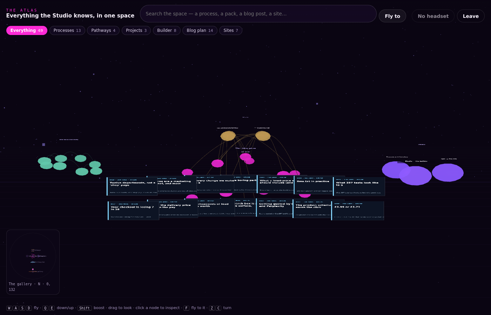
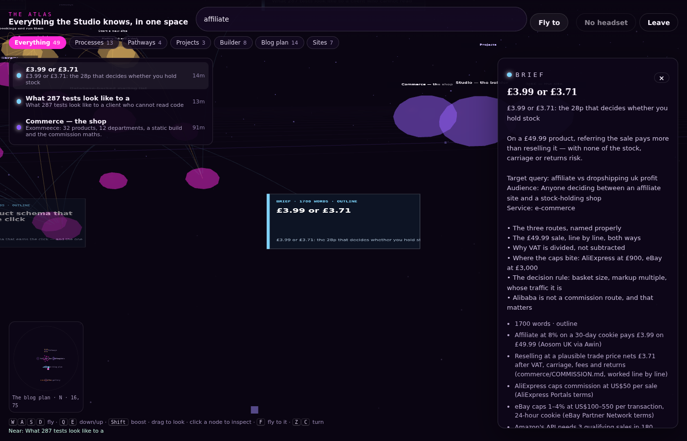
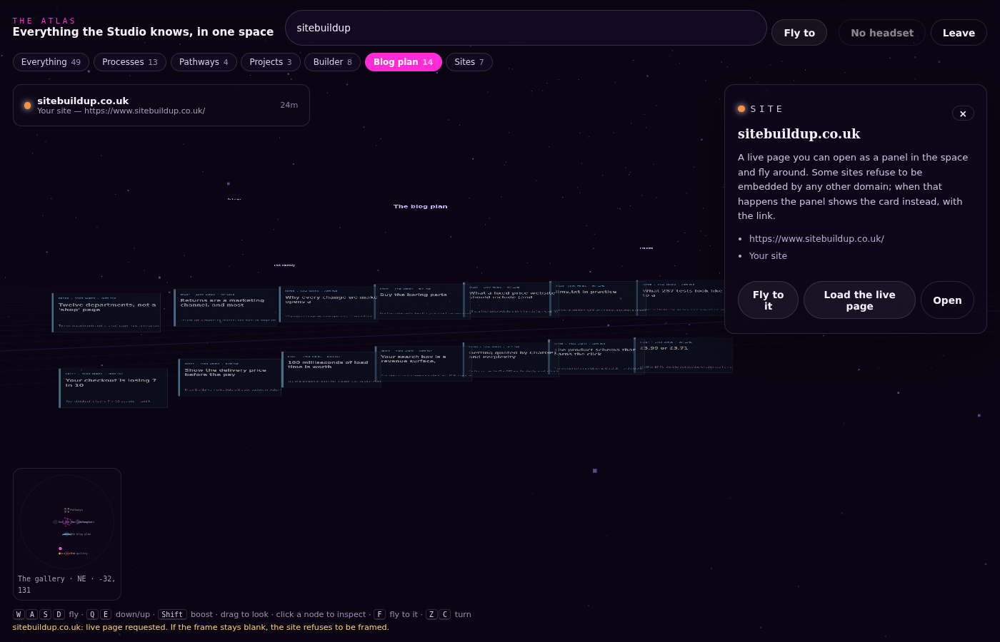
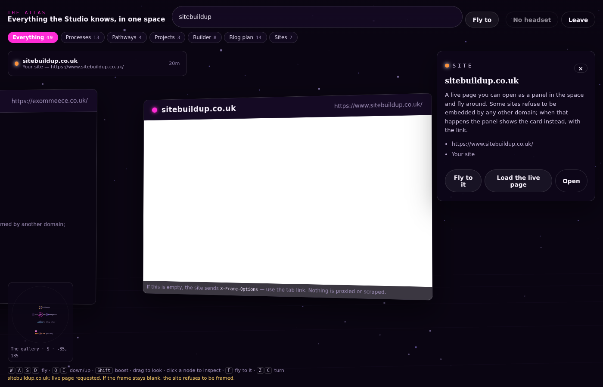

# The Atlas — one space for everything the Studio knows

Built 20 Nov 2026. It lives in the Studio at the **Atlas (3D)** tab, and it opens
without a GitHub token: the gate has a second button, *Walk through the Atlas
first*, because the space is local data, not an API call.


## What is in the space

49 nodes, six districts, laid out as a place rather than a list:

| District | Nodes | What is there |
| --- | --- | --- |
| **The library** | 13 | Every capability the Studio can install, on a golden-angle sphere so no two labels collide |
| **Pathways** | 4 | The packs — whole setups installed as one pull request — hanging above the library, wired to the capabilities they contain |
| **The builder** | 8 | The Studio's own process, step by step, down the left side |
| **The projects** | 3 | This site, the shop, and DJKC — in a ring, sized by what they contain |
| **The blog plan** | 14 | Every post for `sitebuildup.co.uk`, as a two-row wall of cards you can read from across the room |
| **The gallery** | 7 | Live sites as panels in the world |



World coordinates are multiplied by `WORLD_SCALE = 0.62` at the end of
`buildAtlas()`, so the districts are authored at a comfortable spacing and then
compressed for walking speed. The map in the bottom-left corner is the same data
drawn flat, and it tells you which district you are standing in.

## Flying it

| Input | Does |
| --- | --- |
| `W` `A` `S` `D` | Move along the ground plane |
| `Q` / `E` | Down / up |
| `Shift` | Boost (3.2×) |
| Drag | Look |
| Scroll | Dolly forward |
| `Z` / `C` | Turn without the mouse |
| Click a node | Inspect it: the HUD card on the right carries the detail |
| `F` | Fly to the selected node, then look at it |
| District chips | Filter to one kind of thing **and** travel to its district |
| Search box | Search the space — see below |
| `Enter VR` | WebXR, if a headset is attached |

The camera is clamped inside a 300-unit radius and below 160, so you cannot get
lost outside the space. Arriving at a node is a timed flight, not a teleport: the
frame loop eases position and look angles together.

## Search

`searchAtlas()` scores each node field by field:

| Where the word appears | Weight |
| --- | --- |
| The title | 8 |
| The summary line | 5 |
| The bullets | 3 |
| The body | 1.5 |

Whole-word beats substring, so **"affiliate" opens the post about affiliate
commission (£3.99 or £3.71), not the shop that mentions it in its detail**, and
there is a test that says so. Empty or nonsense queries return nothing rather
than noise. `bestMatch()` is the "fly to what the query means" version of the
same thing.

## The blog plan

14 posts, about 19,200 words as briefs, all written for **sitebuildup.co.uk** and
all arguing from a number this repository can show:

- Your checkout is losing 7 in 10 baskets
- Show the delivery price before the pay button
- 100 ms of load time is worth 3.5% of revenue
- The search box is a revenue surface, and 70% of queries fail on it
- Getting quoted by ChatGPT and Perplexity
- The product schema that earns the click
- £3.99 or £3.71: the 28p that decides whether you hold stock
- Twelve departments, not a "shop" page
- Returns are a marketing channel
- Why every change we make opens a pull request first
- Buy the boring parts: four things no small business should build
- What a fixed-price website should include (and what "from £795" must not hide)
- `llms.txt` in practice
- What 287 tests look like to a client who cannot read code

Each brief carries the target query, the audience, the service it sells, an
outline, the facts with **evidence** (a file path, a provider's terms, a test
count), and the capability it demonstrates. `npm run briefs` renders them all to
[`studio/BRIEFS.md`](../studio/BRIEFS.md).



Clicking the card flies to it and opens the brief in the HUD — the promise, the
outline, and every fact with its source.



## The gallery

Seven sites stand in a row at the far end, each a CSS3D panel in the 3D scene.
Select one and choose **Load the live page** to put the real page inside its
frame; **Open** takes you to it in a tab.



Two honest limitations, both visible in the UI rather than hidden:

- **Sites refuse to be framed.** `sitebuildup.co.uk` sends framing headers, so
  the frame stays white and the panel says so, with the tab link. Nothing is
  proxied, scraped or faked, and the note in the panel says that too.
- **Chromium does not hit-test CSS3D content.** Buttons inside the 3D panels
  cannot receive a click, so the panels are display-only and the real controls
  live in the HUD. That is why the engine binds input to the stage element that
  holds both layers, and why a drag that starts on a panel is ignored.

## VR

`enterVR()` asks the browser for an immersive session; if there is none, the
button says **No headset** instead of pretending. In a session the HUD and the
CSS3D panels hide and the controllers teleport you along the ray.

**Not verified on hardware.** The checks in this repository ran in headless
Chromium, which has no WebXR device, so the honest statement is: the fallback is
tested, the session path is guarded and typed, and a headset has not been tried.

## What is checked

- `npx vitest run` in `studio`: **102 passed**, 23 of them about the space — node
  count and uniqueness, every node in a real district, finite coordinates inside
  bounds, edges that resolve, search ranking, briefs that name real capabilities,
  and a floor on how many briefs carry evidence.
- The whole repository: **287 tests** (66 site, 102 studio, 119 commerce).
- `npm run build` in `studio`: 279.63 kB main chunk, and the Atlas as its own
  lazy chunk of 596.62 kB — three.js is only downloaded when someone opens the
  space.
- A browser walk in Chromium: the gate opens the space, the canvas draws, search
  flies to a post, a site's panel loads a live page, the district chips travel,
  `W` moves, and **zero console or page errors**.

## Files

```
studio/src/atlas.ts          the data: nodes, districts, edges, search, compass
studio/src/atlasBriefs.ts    the 14 blog briefs, with facts and evidence
studio/src/atlasEngine.ts    three.js: scene build, flight, picking, labels, panels, WebXR
studio/src/components/Atlas.tsx  the HUD: search, filters, detail card, minimap
studio/src/atlas.test.ts     23 tests, no three.js needed
studio/scripts/write-briefs.mts  renders BRIEFS.md
```
