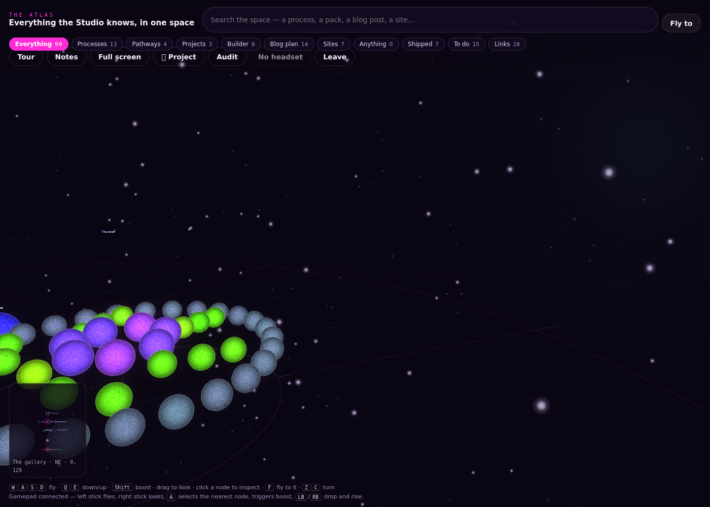
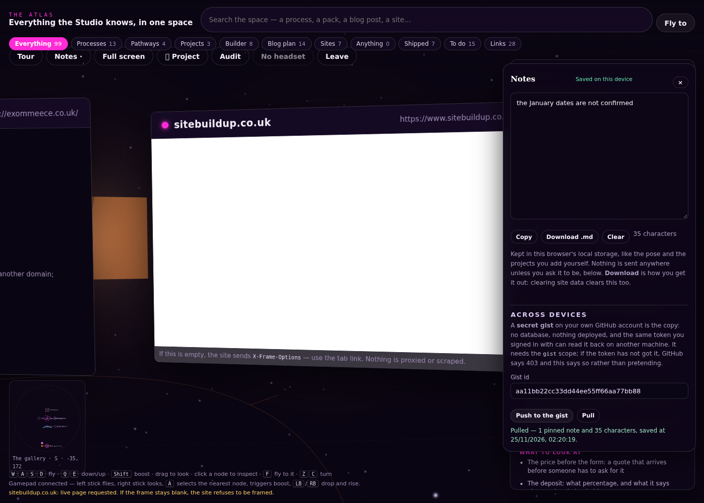

# The last five on the shelf, built

*2026-11-20*

Yesterday's list had six `later` items. The command palette went in the same
round as the project pages; these five are the rest. All five are off the todo
list because they are built, not because they were renamed.

| Was on the shelf | Now |
| --- | --- |
| A gamepad | Left stick flies, right stick looks, triggers boost, LB/RB drop and rise, A selects the nearest node |
| Preview images for the sites' links | `/api/site?thumb=<url>` returns the card a link makes; the panel draws it |
| The Studio as an installable app | `manifest.webmanifest`, four icons, a service worker that keeps the shell |
| A note pinned to a node | A field in every node's panel, saved in this browser |
| Notes that sync across devices | Push and pull to a **secret gist** on your own GitHub account |

## A gamepad is two sticks, which the space already had

`studio/src/gamepad.ts` reads a pad and returns exactly what `setMoveInput` and
`setLookInput` already take — the deadzone, the clamping and the `-0` fix are the
same code the glass sticks use, so a thumb and a thumbstick cannot disagree.
`interact` is a rising edge, not a level: holding A selects a node once, not
sixty times a second.

Polled with `requestAnimationFrame`, and only handed to the engine when a number
actually changes. If no pad is there the loop costs one `getGamepads()` call per
frame and nothing else. When a pad appears, a line under the keyboard help says
what its sticks and buttons do.

Checked in a browser with a fake pad injected into `navigator.getGamepads`:
holding the left stick away walked the HUD from `0,146` to `0,139`, and pushing
the right stick turned the heading `N → NE`. Not checked: every controller on
earth. The mapping assumed is the W3C standard one every modern pad reports.

## The card behind a link

A browser cannot read another site's HTML, so `/api/site` grew a `GET`:
`?thumb=<url>` fetches the page through the same guard as the audit (https only,
public hosts, no credentials, default port, no redirects followed, 8 s timeout,
1.5 MB ceiling) and returns `og:image` — or `twitter:image`, or `og:image:url` —
made absolute, with the title and description beside it. Only https images
survive; a `data:` URI is not a preview.

Link cards are cached for an hour at the edge (`s-maxage` a day): a page's share
card changes about as often as the page does. The panel draws it for site and
link nodes, and says "that page declares no picture" rather than showing a hole.

## The Studio as an app

`public/manifest.webmanifest` — standalone display, `#0A0512` background, three
icons plus a maskable one and an Apple touch icon, all four generated from the
same mark and checked for real PNG dimensions by a test. `public/sw.js` caches the
shell (`/`, `/index.html`, the manifest, and every asset it is asked for) so the
Studio opens with no network, and **refuses to cache anything under `/api/`**:
a stale GitHub or Anything answer would be a lie.

Registered only when `import.meta.env.PROD`, because a dev server served from a
cache is a dev server that lies about what is running. When the browser says it is
offline, the header says so too: *"Offline — the space and the shelf still work"*.

## Notes, pinned and travelling

Every node's panel now has **Your note on this**, written to
`atlas:node-notes:v1` on each change. The download joins the loose notes and the
pinned ones into one markdown file, with each pin under the node's own name.

**Across devices** is a secret gist on the account you already signed in with:

- *Create a gist* / *Push to the gist* writes `atlas-notes.json` (`version`,
  `notes`, `nodeNotes`, `updatedAt`);
- *Pull* reads it back and merges — a pinned note that exists on this device wins,
  the gist fills the gaps, and an empty loose note is replaced by the remote text;
- a token without the `gist` scope gets GitHub's 403 turned into a sentence:
  "add the `gist` scope to it". Nothing pretends to have synced.

Verified end to end against a stubbed GitHub: push wrote both the loose note and
the pin; clearing this device's storage and pulling brought back the text and the
pinned note, and the status line said which it was (`1 pinned note and 35
characters, saved at …`).

**Limit, stated:** a gist is private-by-link, not a safe. Anyone with the id and a
token of yours can read it; GitHub's own security page is the authority on what a
secret gist is worth.

## What the tests now say

197 in the studio across 24 files (was 181/21): 9 for the gamepad, 7 for the gist
sync, 5 for pinned notes, 5 for the link card, 6 for `/api/site`, 5 for the
installable app.

## Still on the shelf

Nothing that was on yesterday's list. The remaining fifteen todos are the older
ones: the shop's payment provider, the site's remaining content, the Anything
writes, and so on — visible in the Shelf tab, which is now the only list.
