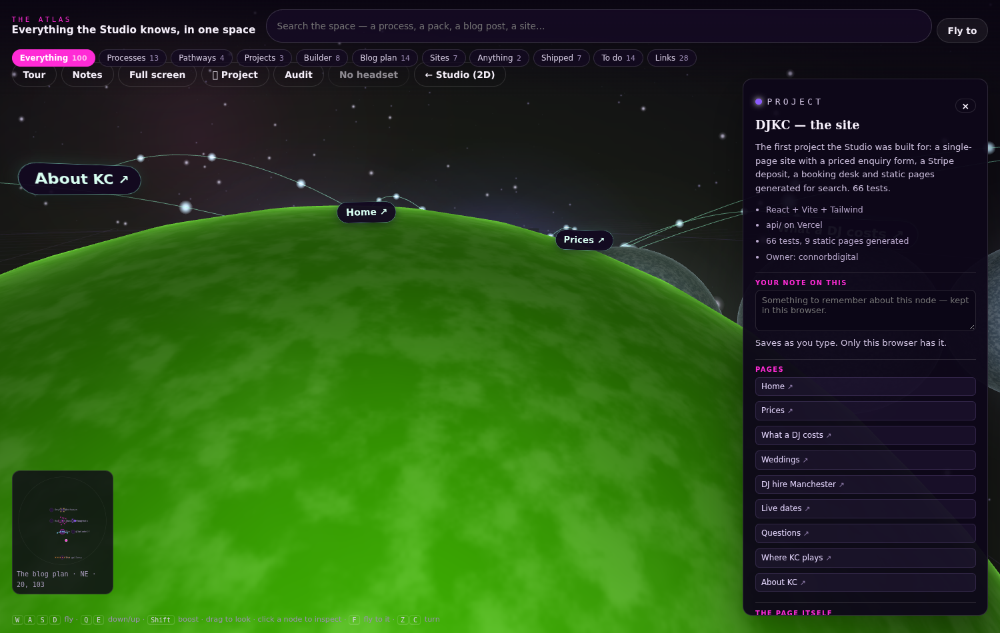

# Wires in the space, and a shop called Ecommerce

*2026-11-20*

Four things: the Atlas as a place where connections are visible, a way back to the
2D Studio from inside it, the Anything suns that were not appearing, and the shop
renamed and given a domain of its own.

## Pages, hanging in the space

Select a project and its **pages become cards in the 3D scene** — each one a real
`<a href>`, ringed around the node at a radius that grows with the count, facing the
centre so they are readable from inside the ring, and joined to the node by a curve.

## Streams along the wires

Every wire that touches the selected node now carries **particles**: soft round
specks built from a radial-gradient canvas texture, five per wire, moving from one
end to the other and looping. The node's own wires brighten while the rest keep
their distance fade, so the question "what is this attached to?" is answered by
looking rather than by reading.

Both are rebuilt whenever the selection changes, and disposed with it, so a
hundred selections do not leave a hundred card elements in the DOM.

## A way back to the 2D Studio

The Atlas header's "Leave" is now **← Studio (2D)**, and the detail card carries
*"Open this in the Studio (2D)"* — the same place, reachable from the thing you are
looking at rather than only from the corner of the screen.

## Why no Anything suns were in the space

The Atlas asked for every app *and* its details before drawing any of them. If the
detail call failed, the whole result was treated as a failure and the space got
nothing — no suns, no explanation.

Now the detail failure falls back to the plain project list, so **the suns stand
even when their contents cannot be read**, and a sentence appears under the title
saying what happened (`Anything: <reason>`). That is the difference between a space
with a hole in it and a space that tells you why the hole is there.

## Ecommeece → Ecommerce, with its own domain

The name was a misspelling of "ecommerce" and had outlived its usefulness. It is
now **Ecommerce** everywhere it is data: the brand and legal name in
`commerce/catalogue/site.ts`, the brand column in `products.csv`, the basket
storage key, the Atlas site record (`site-ecommerce`), the project's page list, and
the shelf entry — which now reads "replace the demo name with the real one" instead
of "confirm the brand name".

The shop is also a **Vercel project of its own**: `ecommerce`, linked to this
repository with root directory `commerce`, build command `npm run site`, output
`catalogue/dist`. Pushing to `main` deploys it.

- Shop: https://ecommerce-two-psi-13.vercel.app
- Studio: https://studio-connorbdigital.vercel.app
- The band's site: https://kaysie.sitebuildup.co.uk

`ecommerce.vercel.app` was already taken, so Vercel named the project
`ecommerce-two-psi-13`; the brand URL, the `og:url`, the sitemap and the Atlas all
say so. If you would rather have a nicer domain, add it in Vercel → ecommerce →
Settings → Domains and tell me the name; one constant in `commerce/catalogue/site.ts`
changes every page.

## Checks

- Commerce: 119 tests, `npm run site` clean (32 products, 0 rejected, 0 validation issues).
- Studio: 200 tests; root: 67.
- Browser: with the Anything detail calls deliberately failing, the space still
  showed **2 Anything** suns and the note under the title; selecting the DJKC project
  drew nine page cards with real hrefs (`https://kaysie.sitebuildup.co.uk/…`), the
  streams ran, and both 2D links were present. Switching selection removed the cards
  and built the new node's.
