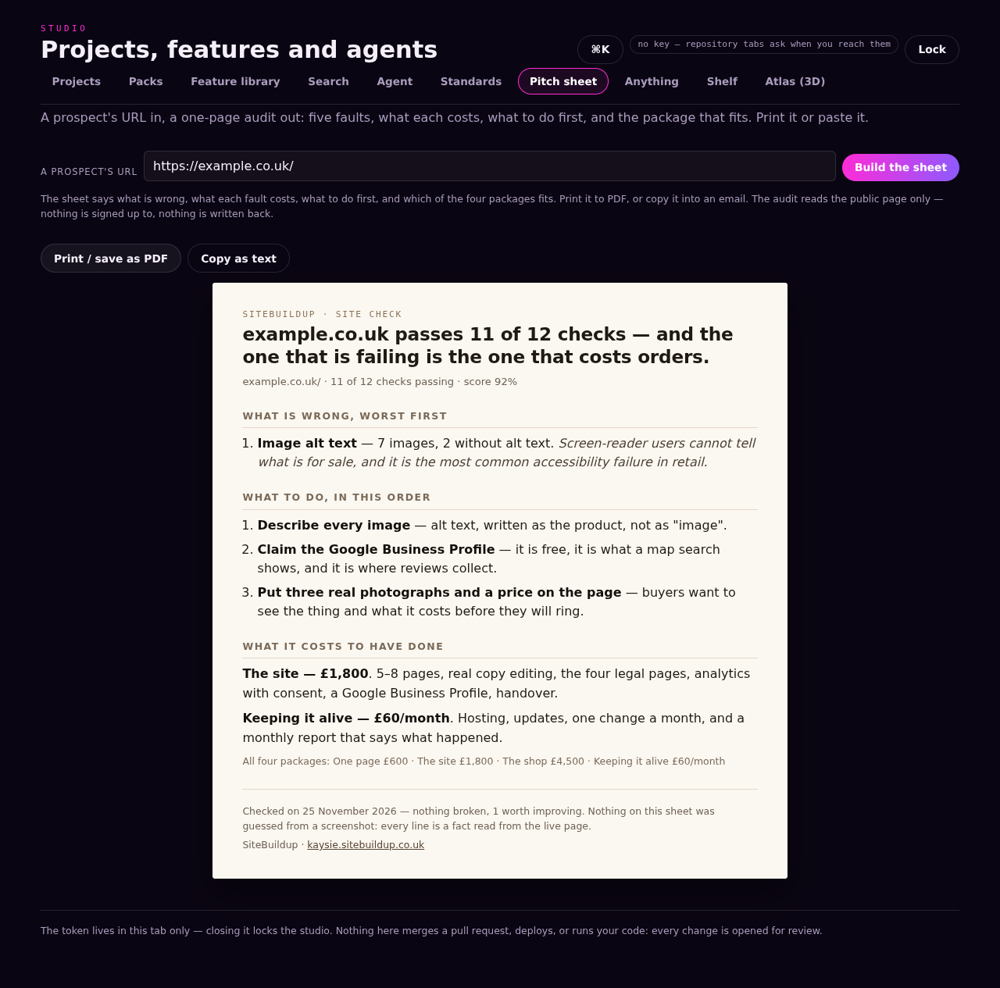

# A shop that can take money, and a sheet that sells the work

_20 November 2026. Two things shipped together: the checkout Hearth & Grain has
never had, and the one-page audit the Studio can now print for a prospect._

---

## 1. The checkout

### What it does

The shop's basket was already real — a catalogue, quantities, a total in
`localStorage` — and the button underneath it said *Checkout — not connected*.
That button now works:

| Step | Where | What happens |
| --- | --- | --- |
| Basket totals | `catalogue/render.ts` | Subtotal, delivery and grand total, worked out as items are added: free over £40.00, otherwise £3.95. |
| Checkout | the button in the basket | Sends **ids and quantities only** to `POST /api/checkout`; the browser never names a price. |
| Pricing | `lib/pricing.js` | `priceBasket()` reads `lib/catalogue.js` — the same CSV the shop is built from — merges duplicates, clamps to 10 per line, skips out-of-stock lines, and returns the total. |
| Payment | `api/checkout.js` | Builds a Stripe Checkout session by hand (`application/x-www-form-urlencoded`, no SDK, no dependency), with delivery as its own line so a free order still shows £0.00. |
| Return | `pages/order-complete.html` | A real page: thank you, what happens next, and what this demonstration shop still does not do. |

### The honest failure, kept honest

With no `STRIPE_SECRET_KEY` on the project the endpoint answers **503** and the
basket prints the sentence under the button:

> Payments are not switched on yet. The basket is priced and the delivery is
> worked out (£28.00 + £3.95), but no Stripe key is set on this deployment, so no
> card is taken. Set STRIPE_SECRET_KEY in the ecommerce project and it starts
> working.

That is a real 503 with the real arithmetic in it, not a disabled button.

### The contract

```
GET  /api/checkout
  → {ok:true, checkout:"alive", key:"set"|"missing", mode:"live"|"test"|"none",
     catalogue:32, freeOver:"£40.00", delivery:"£3.95", currency:"GBP"}

POST /api/checkout  {items:[{id, qty}]}
  → 200 {ok:true, id, url, priced:{subtotal, shipping, total}}
  → 400 {ok:false, error, problems:[…]}          a bad or unknown line
  → 503 {ok:false, configured:false, priced, error}   no key
  → 502 {ok:false, status, error}                Stripe refused it, in Stripe's words
```

### Switching it on

1. Create a key at <https://dashboard.stripe.com/apikeys> (`sk_test_…` first).
2. Vercel → project **ecommerce** → Settings → Environment Variables →
   `STRIPE_SECRET_KEY`, type Sensitive, then redeploy.
3. `GET /api/checkout` now says `"key":"set","mode":"test"`, and a basket reaches
   Stripe's own page. Use test card `4242 4242 4242 4242`, any future expiry.
4. `SHOP_URL` is optional: the success and cancel URLs are built from the request
   host, so the deployed domain works without configuration.

### What it does not do yet

No webhook, so no order record, no order email and no stock movement. Stripe's
receipt is the confirmation and the Stripe dashboard holds the order. That is the
next item in the Studio's Shelf (`shop-order-email`), and it is also in
`docs/not-yet-done-2026-11-20.md`.

---

## 2. The pitch sheet

**Studio → Pitch sheet.** A prospect's URL goes in; one printable A4 page comes
out.

- **Five faults, worst first** — failures before warnings, weighted by what they
  cost, each with a consequence an owner recognises ("a phone shows a desktop page
  squeezed into a phone screen").
- **Three things to do, in order** — the cheapest loss first. If the audit finds
  fewer than three faults, the plan is padded with standing advice (Google
  Business Profile, real photographs and a price, three reviews), clearly not
  dressed up as an audit finding.
- **What it costs to have done** — the package the findings actually point at,
  plus one companion. Commerce evidence plus a broken commerce check selects
  *The shop*; a thin page selects *One page*; everything else *The site*.
- **Two exits** — `Print / save as PDF` (print stylesheet: A4, chrome removed) and
  `Copy as text`, which produces an email-ready block under 2,400 characters.

The rules live in `src/pitch.ts` (`buildPitch`, `offerFor`, `pitchText`), the
screen in `src/components/Pitch.tsx`, and the 8 tests in `src/pitch.test.ts` check
the failure ordering, the padding, the package choice, the honest empty case, and
that the paste fits an email.



It is built from the same `checkSite()` report the Atlas uses, so the sheet and
the Studio cannot disagree about a page.

---

## 3. The Anything 401

The bridge's pulse said `"key":"set"` with two names configured —
`ANYTHING_API_KEY` and `Anything_Key` — and Anything answered **401**.

Anything's published scheme is right in the code — Basic auth, the key as
username, empty password — so the 401 is about the *value*, not the scheme.

The pulse was also misleading: it printed `keyNames:["ANYTHING_API_KEY",
"Anything_Key"]`, which reads as two keys configured. That list is what the bridge
**looks for**. Checked against Vercel's API, the Studio project holds only
`Anything_Key` (sensitive, all three environments) — there is no
`ANYTHING_API_KEY`. So one key is set, and Anything refuses it.

Changed:

- **The pulse now reports what is configured** (`keyNames`) and separately what it
  looks for (`keyNamesLookedFor`). The two were the same field.
- **`cleanKey()` strips the three paste artifacts that look like valid keys**:
  surrounding quotes, whitespace (including a key wrapped across two lines), and
  a trailing colon — Anything's docs print the example as `anything_xxx:` because
  Basic auth adds the colon, so pasting it with the colon sends two and 401s.
- **Every configured key is tried**, canonical name first, so a stale duplicate
  cannot shadow a good one.
- **`GET /api/anything?probe=1`** reports, per stored variable: its length, whether
  it starts with `anything_`, whether it arrived with quotes/whitespace/a colon,
  whether it looks like a signed token, whether every character is one a key can
  contain, whether it is the example from Anything's own docs (`anything_xxx`),
  what Anything answered, and which name is accepted. No key is ever printed.
- **Invisible characters are stripped too**: a no-break space, zero-width space,
  word joiner or byte-order mark from a rich-text copy survives every visible
  check and turns a correct key into a 401. (Found by the second live report:
  quoting, whitespace and a trailing colon were not enough to explain it.)
- **The probe now says which of the three it is**: pasted example, paste artefact,
  or a right-shaped key that is dead or from another account — because those need
  the same action but not the same explanation.
- **The name is matched loosely.** Vercel is case-sensitive, and `anything_api_key`
  — what a person actually types — read as "no key set", which then told him to
  add the thing he had already added. Any variable whose name normalises to
  `anythingapikey` or `anythingkey` is taken as the key.
- **Three auth schemes are tried, Basic first.** The live value was 150 characters
  starting `anything_`, plain ASCII, and still refused: the right shape. That
  leaves either a dead key or an API reading a header we were not sending, and the
  second costs nothing to rule out from inside the bridge. Basic stays first and a
  working Basic key never pays for the experiment; after a 401 the bridge tries
  `Bearer` and `X-API-Key`, keeps whichever works for ten minutes of warm
  instance, and the probe reports every header it tried.
- A 401 now names the variables and their shapes, and points at the probe.

The Anything tab links straight to the probe when it is refused. **If the probe
says the key is refused, the value is stale or from another account — replace it
with a fresh key from Anything → Settings → API keys and redeploy.**

---

## 4. What is still not done

| Gap | Where it hurts |
| --- | --- |
| No Stripe key on the deployment | the checkout answers 503; nothing can be bought yet |
| No webhook, order record or order email | a payment that leaves no order to refund or re-send |
| No legal pages (privacy, terms, cookies, accessibility) | the shop cannot lawfully take an email, let alone a card |
| No analytics or consent | every shop decision is a guess |
| No stock movement | an order does not reduce availability |
| The catalogue is invented | 32 placeholder products from a generated CSV |
| No rate limit on the audit endpoint | the pitch sheet is cheap to abuse once it is public |
