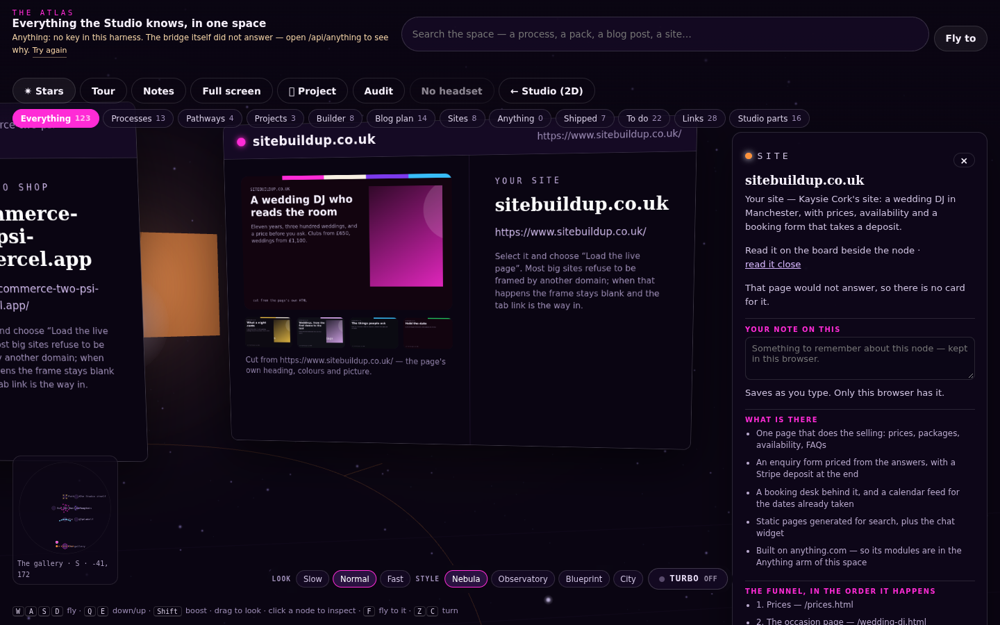
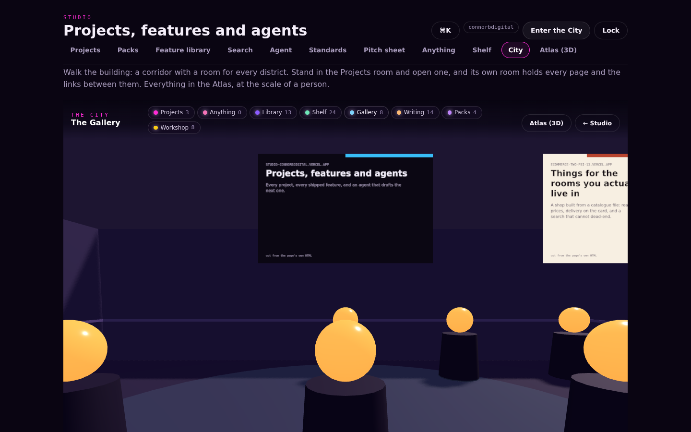
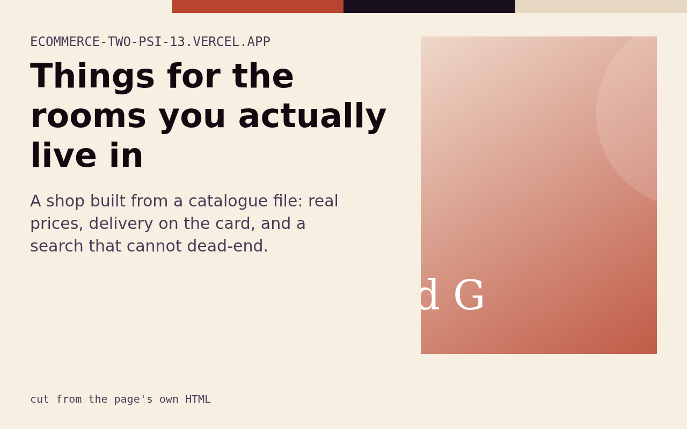

# Plates: what a page looks like, taken from the page

*20 November 2026. The answer to "is there any imagery in the space?" — there is now, and this file says exactly where it comes from.*

## The problem this fixes

The Atlas and the City were built entirely out of geometry: drawn stars, drawn
windows, drawn labels. Nothing in either space showed what a page, a theme or a
funnel actually looked like. The one exception was a live `<iframe>` inside a
gallery panel, which only works when the site allows framing — and four of the
eight gallery sites say they may not.

A plate is that exception made general and honest: **a picture assembled from a
page's own HTML** — its title, its first heading, its own colour variables, and
its own share picture — drawn on a canvas and hung where that page belongs.

## What a plate is, and what it is not

It is an extraction, not a screenshot. There is no headless browser behind this:
the bytes are fetched once, server-side, parsed, and the result is a small set of
facts. Every plate carries the line *"cut from the page's own HTML"* so nobody
can mistake it for a screenshot.

What that costs, stated plainly:

- A page whose colours are in a linked stylesheet declares no custom properties
  in its HTML, so its plate falls back to whatever hexes it names inline — or to
  a neutral plate with no palette at all. The plate never invents a colour.
- A page with no `og:image` and no `` gets no picture, and the slot is
  washed in the page's own colour rather than filled with a placeholder.
- Sites that refuse framing still refuse it. The plate is unaffected — it is
  drawn, not embedded — but the *live page* button still ends in a blank frame
  for them, and the panel says so.

## Where the facts come from

| Field | Where it is read from |
|---|---|
| `title` | `og:title`, else `<title>`, else the host |
| `h1` | the first `<h1>`, tags stripped, entities decoded |
| `description` | `og:description`, else `<meta name="description">`, cut at 220 characters |
| `palette` | `<meta name="theme-color">` first, then every `--custom-property` holding a hex, in declaration order, de-duplicated, capped at six; inline `style="…"` hexes only when the page declares nothing |
| `image` | `og:image`, then `og:image:url`, `twitter:image`, `twitter:image:src`, then the first `` — resolved against the page URL, `http(s)` only |

Everything else on the plate is layout: a band of the page's colours, the
heading, the description, the honesty line.

## The two endpoints

`api/site.ts` gained two branches, both reusing the existing guard
(`src/sitecheck.ts`: https only, public hosts only, no credentials, default port,
8 s timeout, byte ceiling) and the existing reader:

- **`GET /api/site?plate=<url>`** — fetch, parse, return
  `{ ok, plate: { url, title, h1, description, palette, image, truncated } }`,
  cached `s-maxage=86400`. The picture is rewritten to the second endpoint, below,
  because a cross-origin image taints a canvas and WebGL then refuses the upload.
- **`GET /api/site?image=<url>`** — the bytes themselves, `image/*` only, 2.5 MB
  ceiling, `X-Content-Type-Options: nosniff`, cached `max-age=86400`. Same-origin,
  so a canvas may take them.

This is a fetch proxy for public images. It is the same posture as the existing
page checker — not a security boundary, and it says so in the file — and it
exists because there is no other way to put another site's picture into a
texture.

## Where plates appear

**The Atlas: every gallery site's panel.** The panel used to be a card with a
"load the live page" button. It now opens on the plate: the page's heading, its
colours as a band, its own picture, and beneath it **the funnel** — one small
plate per step of the path a buyer actually walks. Selecting a site no longer
loads its iframe by itself (it used to, which meant the plate was never seen);
"Preview in the space" loads the page, and leaving the site — or pressing "Show
the plate" — puts the plate back.

**The City: above every plinth in the Gallery room.** Each site's plinth was a
label. It is now the page itself, drawn as a texture, hanging over the plinth so
you can walk up to it and see what the site looks like. Two at a time, nothing
shown until it is real.

**The funnels** are declared in `src/atlas.ts`, on the two sites we built, as
real paths:

- the shop: `/` → `/shop.html` → `/department/home.html` → `/product/bamboo-folding-shelf-rack.html`,
  with the note that it stops at the product page because no payment provider is
  connected;
- the site: `/prices.html` → `/wedding-dj.html` → `/faq.html` → `/index.html#booking`,
  with the note that there is no cart because a booking is a conversation.

A site that is not ours gets no funnel. Guessing at someone else's checkout is
the kind of thing this space exists to avoid; `atlas.test.ts` pins that.

## Reading the queue

Plates are read **three at a time** in the Atlas and two at a time in the City,
and cached twice: in memory for the tab, and in `sessionStorage` for six hours
(48 entries, newest first). A plate that fails is a plate that is not hung — the
star and its words are the space, the picture is the addition. Nothing about a
failed read reaches the screen.

## What is verified, and how

`npm test` in `studio/`: **306 tests in 35 files**, including

- `src/plate.test.ts` (16) — hex normalising, palette order and capping, entity
  decoding, absolute image resolution, wrapping and truncation, ink that flips on
  a pale page, every op inside the plate, and determinism;
- `src/plateHandler.test.ts` (7) — the plate endpoint's shape, the image rewrite,
  a page with nothing in it, the guard refusing `http://localhost`, a 404 passed
  through, image bytes with their own content type, `415` for non-images, `413`
  for oversized ones;
- `src/plateClient.test.ts` (4) — one request per URL, escaped query, failures as
  absences, and a plate-shaped object that is not a plate being refused;
- `src/atlas.test.ts` — the funnel section on the node, every step absolute and
  on its own host, and no funnel invented for anyone else.

The screenshots in this folder are from a local run with the plate endpoint's
responses stubbed: this sandbox has no outbound network to the sites themselves,
so the *drawing* and the *hanging* are verified here, and the *reading* is
verified by the handler tests. The live read is exercised by production itself
once deployed — `/api/site?plate=https://ecommerce-two-psi-13.vercel.app/` on the
Studio's domain returns the shop's facts.

## Files

- `studio/src/plate.ts` — facts, palette, layout. Pure, no DOM.
- `studio/src/plateDraw.ts` — layout → canvas → texture. The only file that knows about both.
- `studio/src/plateClient.ts` — caching, queueing, failure-as-absence.
- `studio/api/site.ts` — `?plate=` and `?image=`.
- `studio/src/atlasEngine.ts` — the panel face and the funnel strip.
- `studio/src/components/Atlas.tsx` — reads the plates, fills the panels.
- `studio/src/components/City.tsx` — the plate over every site's plinth.
- `studio/vite.config.ts` — the `api/` handlers now run under `vite dev`, so all of this can be tried without a deploy.

