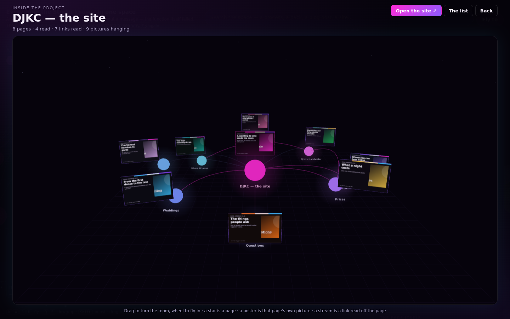
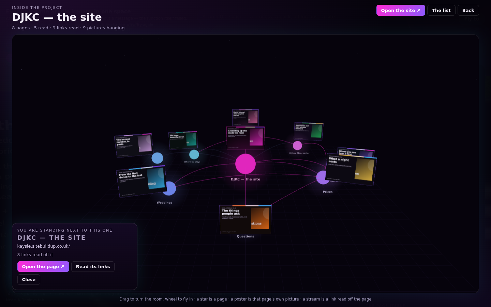
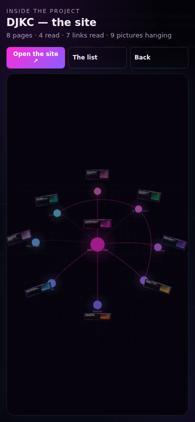

# A project's own space, in three dimensions

*20 November 2026. The page that shows every part of a project — its pages, its
links, its pictures — was a flat overlay. This is the room it became.*

## What was there

Open a project star and you got a full-screen sheet: a hub in the middle, a ring
of circles round it, an SVG line per link, and a list down the right. Honest, and
complete — but flat. A page was a `<circle>`, a link was a `<line>`, and the
picture we had gone to the trouble of extracting from each page (its title, its
palette, its own photograph) could only be shown as a thumbnail in a list.

## What is there now

A room you stand inside.

- **The front page is the sun.** It sits at the middle, lit, and you arrive beside
  it. Its own plate hangs just above it, larger than the rest.
- **Every other page is a star on a ring** around you, in its own colour, with its
  name beneath it. Heights advance by the golden angle, so no two neighbours sit
  at the same height — a ring at one height is a floor with dots on it.
- **Every page that has a picture has it hanging behind its star**, above it and
  outside it: the plate drawn from the real page, hanging like a banner in its own
  bay. Outside, so it never covers its own star; above, so it never covers the
  star next door. Posters turn to face you as you orbit, because a picture you
  have to walk round the room to read is a picture nobody reads.
- **Streams are read, not guessed.** A pink curve joins two pages only where an
  anchor was read off the page itself. Record-only pages keep a faint line and a
  dotted ring. A page that refuses keeps its place and says so in its card.
- **The floor is a grid** far beneath the ring, so the ring has a floor without a
  horizon drawn through the middle of it.

## How it is driven

- Drag to turn the room, wheel (or the two buttons, for touch) to fly in and out.
  On a phone the camera starts higher, so the ring opens into a disc instead of a
  band across the middle with two hundred pixels of nothing above it.
- Click a star: a card names the page, says what was read off it, and gives
  **Open the page ↗** and **Read its links**.
- **The list** is still one button away — the flat ring, the every-page table, the
  same readings. A room you cannot write down is a room you cannot search.
- Escape steps out of the card, then out of the room.

## What is honest about it

Nine pictures is nine `GET /api/site?plate=` calls to the same endpoint the plates
already came from, cached per URL per session as before, all in flight at once so
the room is not empty while it waits. A page that will not answer draws no poster
and no streams — it is a star with nothing behind it, and its card says why.

Nothing was removed. The 2D space still exists and is the list view; the Atlas
still has its stars; the City still has its plinths.

## Files

- `studio/src/space3d.ts` — the arithmetic of the room: ring, posters, arcs,
  framing, colours. Pure, and tested in `space3d.test.ts` (18 tests).
- `studio/src/components/ProjectSpace3D.tsx` — the room itself: three.js scene,
  pointer orbit, raycast picking, plates, streams, card.
- `studio/src/components/ProjectSpace.tsx` — unchanged; it is now the list.
- `studio/src/styles.css` — `.space3d*`, including the phone rules.

