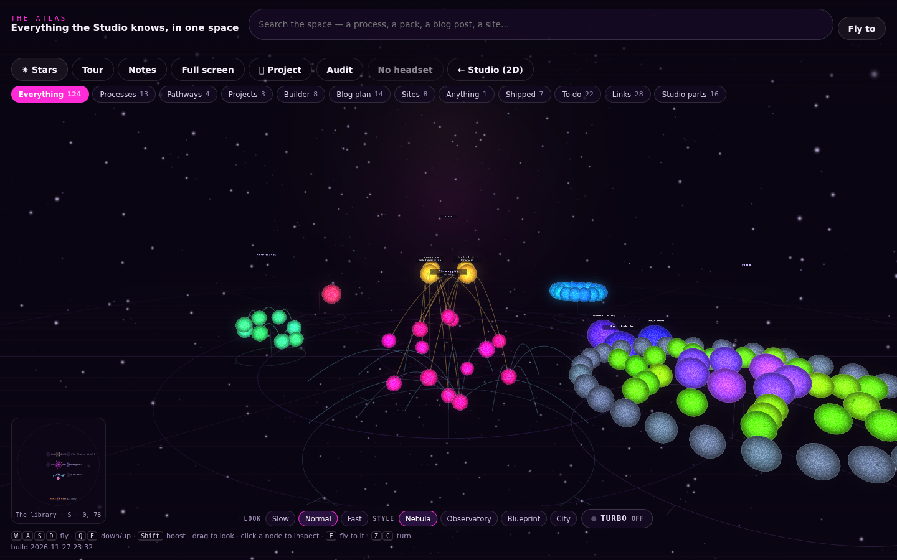
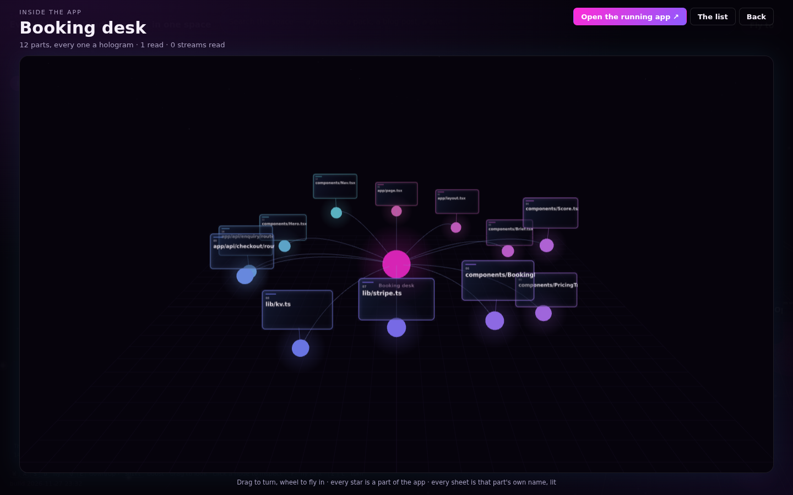

# Stars back, wires on, and an app's parts as holograms

*20 November 2026. Three complaints from the same read of the space, and the
answers — including where the 3D work actually lives.*

## "The stars are still blocks"

The blocks were never the stars. They were the **fourteen brief cards** — the
blog plan — drawn as glass sheets in front of the content arm. The previous
change faded them to 10% at distance, which is not gone: fourteen faint
rectangles on the horizon are still a wall.

Now a brief exists only when you are near it: **full at 14 units, gone by 46**,
and gone means `visible = false`, not faint. They are also smaller (3.4 × 1.92
instead of 4.4 × 2.48). From the library you see stars.

Because "am I looking at the new build?" is now a fair question, the Atlas footer
carries a **build stamp**: `build 2026-11-27 23:32`. If it is not there, the page
is old; a reload will fix it.

## "I can only see the stream lines when I click on them"

That was literal in the code: the brief → process family was
`line.visible = edge.kind !== "proves"`. It is now always drawn, at about half the
strength of the family before it, and every family's opacity is higher and fades
less with distance. In a project's room the record-only streams (pages the record
says exist, whose links were never read) went from 0.16 to 0.34 so the room's
shape is there before anything is clicked.

## "Clicking an Anything project should go into its own space"

It does now. A star of kind `app` opens its own space on click, the same as a
project's; the panel button still says *What is inside*.

## "All the modules, in 3D, like a hologram"

An app has **parts, not pages**: no picture to fetch and nothing to frame. So in
an app's room each part is a **hologram** — a sheet of glass with the part's own
name on it, a lit rim in the part's colour, its index in the corner, hanging above
its own star and tied to it by a hairline. Two heights alternate round the ring so
the sheets do not read as a fence, the ring closes in to keep the names legible,
and the room's head says what it is: *12 parts, every one a hologram*.

## Where the 3D work lives

- `studio/src/atlasEngine.ts` — the main space: stars, districts, wires, the
  holographic briefs, the site panels, the camera.
- `studio/src/components/Atlas.tsx` — the HUD, search, sheets, and the door into
  a node's own space.
- `studio/src/space3d.ts` — the arithmetic of a room: the ring, where posters
  hang, the arcs, the framing.
- `studio/src/components/ProjectSpace3D.tsx` — the room itself: three.js scene,
  orbit, picking, plates, the CSS3D layer for real pages, and the app holograms.
- `studio/src/pageProxy.ts` — the sanitiser that lets a real page be framed.

