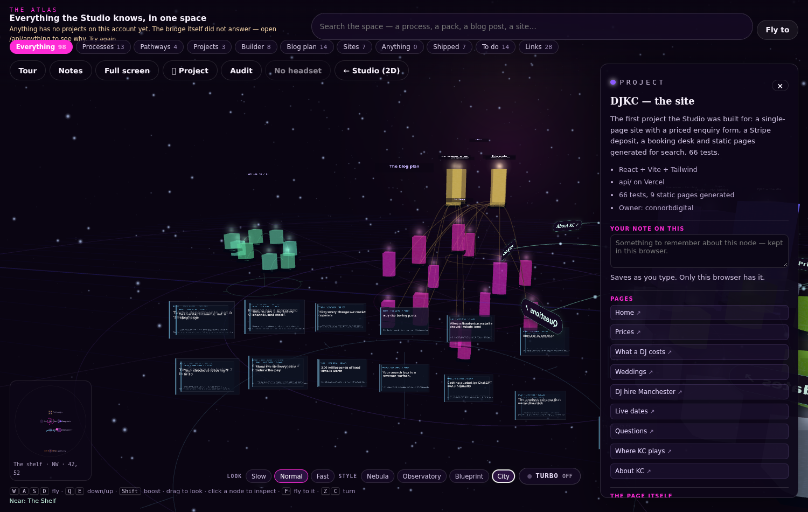
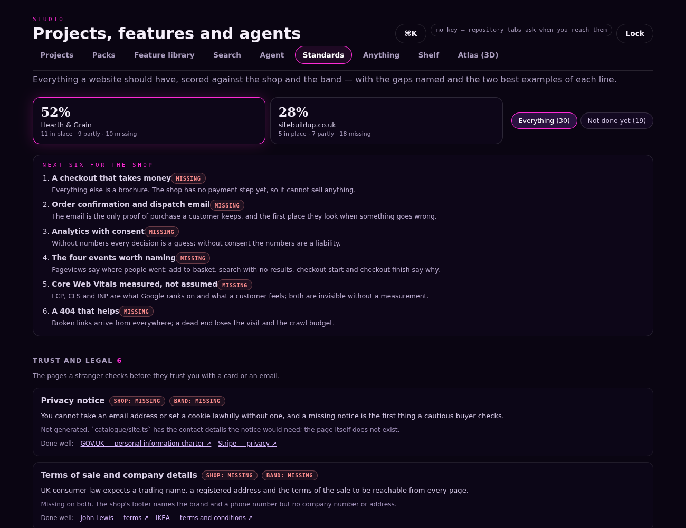

# The city, the board, and no more token bounce

*2026-11-20*

Six things: the city the Atlas can become, a 2D Studio that does not throw you
back to the gate, a board of everything a website should have, a real name for
the shop, a bridge that explains itself, and the research behind the client plan.

## The city

**Style → City** turns every node into a building: a footprint, a height that says
how much is in it (projects are towers, links are low blocks), façades of lit
windows drawn from the district's own colour, a plinth on the grid, and a crown of
light on the roof. The suns go away; the wires stay, and they now read as streets.

It is not a paint job — the geometry is different — so the nodes are rebuilt on the
switch, and your selection is put back with its page cards and its streams. Two
details that mattered: the gallery's live-page screens are hidden in the city (a
row of TVs on the pavement), and if you are inside a sun when you switch, the camera
backs off to the skyline rather than starting inside a wall.

## No more token bounce

Three faults, one symptom — "click anything and it asks for the token again":

1. **A transient failure forgot the token.** The shell cleared it on *any* error
   from GitHub. A rate limit, a proxy hiccup or a dead connection threw away a
   perfectly good key and dropped you at the gate mid-session. Now only a **401**
   forgets the key; everything else shows the message and keeps you where you are.
2. **The Atlas had nowhere to go.** Closing the space returned you to a repository
   tab, which needs a key — so the gate. Now the Studio opens **without a key at
   all**: the Atlas, the shelf, the notes, the standards board and the Anything
   reading are all open, and the five repository tabs ask for a key **in place**,
   with a card that explains what it is for, only when you reach them.
3. **The gate had one exit.** It now has two: *Open the Studio without a key* and
   *Walk through the Atlas first*.

Verified: leaving the Atlas lands on the Shelf, not the gate; a 500 from GitHub
leaves the session intact; all nine tabs open without a key and only the five
repository tabs show the inline prompt.

## The Standards board

A new tab: **everything a website should have**, thirty lines in seven areas —
trust and legal, selling, being found, performance, accessibility, data, brand —
each scored for **both** sites, each with a sentence on what breaks without it,
each with the line in the repository or the reason it is not there, and two
examples of it done well, one British and one not.

The honest headline: **Hearth & Grain 52%** (11 in place, 9 partly, 10 missing) and
**sitebuildup.co.uk 28%** (5 in place, 7 partly, 18 missing). The first six gaps
for the shop are a checkout, order email, analytics with consent, the four events,
Core Web Vitals and a 404 — the first six for the band are its proof, its prices,
its company details, its analytics, its structured data and its search.

## Ecommerce → Hearth & Grain

"Ecommerce" was a category where a name should be. The shop is now **Hearth &
Grain** — homeware, garden and kitchen, the useful things — with `HG-` product
codes (was `EX-`), a matching basket key, and every page, feed, sitemap, structured
data block and Atlas record following from the one constant in
`commerce/catalogue/site.ts`.

- Shop: <https://ecommerce-two-psi-13.vercel.app> (the project name in Vercel was
  taken; add a domain and one constant changes every page)
- Studio: <https://studio-connorbdigital.vercel.app>

## A bridge that explains itself

The Anything proxy now:

- answers **`GET /api/anything`** with its own pulse — alive or not, whether it can
  see the key, which paths it forwards, which Node it runs on — so "500" can be
  read instead of guessed;
- **never passes a 5xx through**: failures come back as a sentence with the
  upstream's own words;
- tries the list three ways (as asked, plain, then per organisation from
  `/v0/api/me`) before giving up;
- is wrapped, so a crash is JSON rather than an HTML error page;
- and the Atlas note appends the pulse result, so a broken bridge and a broken key
  are different sentences.

## The research

Two documents came out of the same message:

- **[What SiteBuildup needs to actually get clients](sitebuildup-clients-2026-11-20.md)** —
  2026 UK price bands with sources, what wins the work (Google Business Profile,
  referrals, a niche, proof, build-first pitching), four fixed packages, and a
  thirty-day plan.
- **[Everything suggested that is not done yet](not-yet-done-2026-11-20.md)** —
  twenty-seven open items, ordered by what it costs to leave them.

## Checks

- Studio: 207 tests (7 new on the board and its honesty), `tsc --noEmit` clean,
  production build clean.
- Commerce: 119 tests, 45 pages rebuilt as Hearth & Grain, 0 validation issues.
- Root: 67 tests.
- Browser: city renders and rebuilds on switch; Standards board renders 30 lines in
  7 areas with 52% / 28%; the gate's two exits work; nine tabs open keyless.
