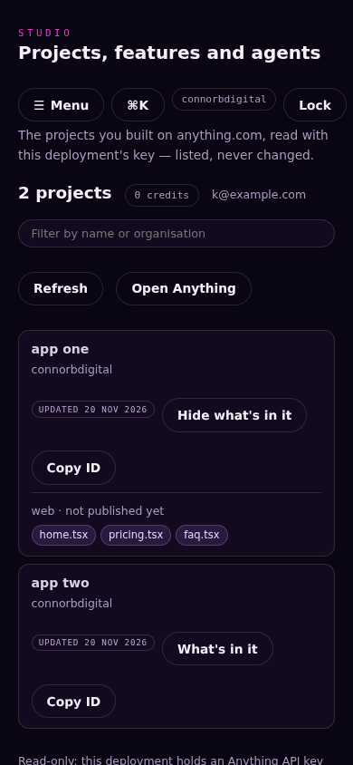
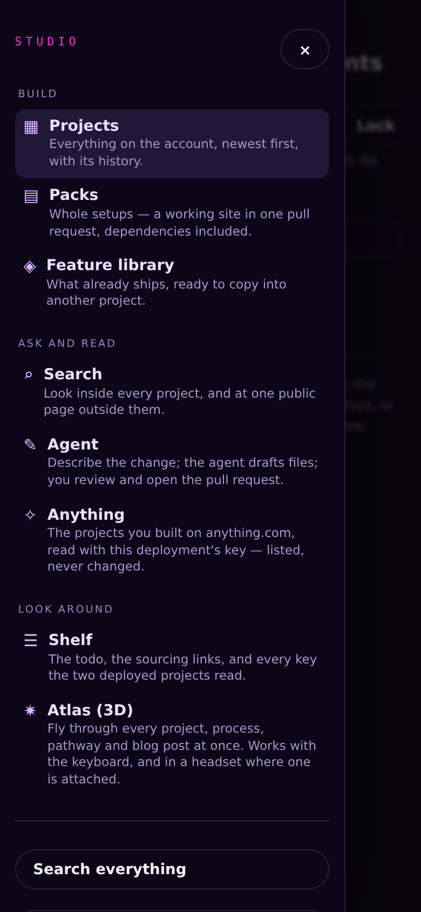

# Everything from Anything, and a way round on a phone

*2026-11-20*

Three questions came in together: is *everything* from anything.com here, how is the
Studio organised for real work, and does the phone get the same Studio as the laptop.
The first two had honest answers; the third had a bug.

## What the Anything tab actually showed (and now does)

Before this round it asked the API for the project list, then asked for the **detail
of the first 24** and drew those. That is not "everything":

| | Before | Now |
| --- | --- | --- |
| Projects listed | first 24 of the list | **every** project the API returns (asked for 100, its documented ceiling) |
| What is inside | only for those 24 | on demand — **What's in it** on any project, read when you ask |
| Requests before the list appears | 1 list + 1 identity + 24 details | 1 list + 1 identity |
| A project the API refuses | silently missing its modules | the row says so |

The list is now one call, and the contents of a project are a second call made
only when you open that project. Files come back as chips; the published URL gets
an **Open** button; a project that fails says why instead of looking empty.

**The honest part:** I cannot see your Anything account from here — this sandbox
can reach GitHub and npm, and `api.anything.com` is not on the list. So what I
fixed is the part that is code: the tab no longer caps at 24, no longer hides a
failure, and no longer spends 24 requests before it can draw. If the tab still
shows fewer projects than you have, the API's own answer is the limit and the
Studio now has nothing left to hide it with. Every project also becomes a sun in
the Atlas.

## A menu for the phone

The eight tabs were one row that scrolled sideways on a phone — that is not a way
around, it is a row. Under 720 px the strip is gone and a **Menu** button opens a
drawer with the same eight things, grouped:

- **Build** — Projects, Packs, Feature library
- **Ask and read** — Search, Agent, Anything
- **Look around** — Shelf, Atlas (3D)

Each row carries the glyph, the name and the sentence that explains it, so the
drawer doubles as the only page that describes the whole Studio. Escape closes it,
tapping the scrim closes it, the page behind it does not scroll, and the footer
holds **Search everything** and **Lock**. On a laptop nothing changed: the strip is
still there and the button is hidden.

Also fixed on the way: the ⌘K key cap button is hidden under 560 px (the drawer has
"Search everything"), and an opened Anything project no longer pushes its own
buttons off the screen — the detail is a row of its own under them.

## The key that was never read — fixed in code

The Shelf has said for days that the site's chat widget has never answered because
Vercel holds `OPEN_AI_KEY` and `api/chat.ts` reads `OPENAI_API_KEY`. Vercel treats
that variable as *sensitive*, which means **no one can read it back** — not the
dashboard, not the API, not me — so "rename it" would mean pasting the secret again.

`api/chat.ts` now accepts either spelling, preferring the canonical one. The widget
starts answering on the next deploy of the site with nothing re-entered, and the
shelf entry is gone because it is fixed. Test: with `OPENAI_API_KEY` empty and
`OPEN_AI_KEY` set, the handler calls the provider with that key.

The other stale shelf entry — "Add ANTHROPIC_API_KEY to the studio" — is now
"Give the Studio's Agent a key on preview too": the key exists for Production, so
the Agent works live and refuses on every preview deployment.

## Organising it more productively — what I did, and what I would do next

Done here: the three groups above are now a real property of the tabs (`group` on
each entry), so the drawer, and anything else that reads the list, cannot drift
apart; Anything is a list you can search rather than a loaded subset; and the Shelf
stops carrying work that is finished.

The next three, in the order I would do them:

1. **A Today view.** The Studio opens on Projects, which is a history. A landing
   that answered "what changed, what is failing, what is on the shelf for now"
   would be the difference between a tool you check and a tool you open.
2. **A project as a workspace.** Right now a project is a repository; its site, its
   Anything app and its open pull requests are in three tabs. Selecting a project
   once and letting the other tabs narrow to it is the single biggest saving.
3. **Pin what you use.** The palette and the drawer both list everything equally.
   Pinning three tabs and three repositories to the top of the drawer costs little
   and cuts most of the navigation.

Say which of those you want and I will build it the same way.

## Checks

- Studio: **200 tests / 24 files** (was 197/24) — 3 new for the Anything list and
  on-demand detail; root: 67 tests, 1 new for the chat key.
- Mobile pass at 390 × 844 with touch: the drawer opens, lists 8 items in 3 groups,
  closes on pick, and the hash follows; Anything lists every project, opens one,
  and the document never scrolls sideways; Packs, Feature library, Search, Agent,
  Shelf and Atlas were each checked for horizontal overflow and none has any.
- Desktop at 1400 px: no Menu button, the strip is back, Anything expands in place.
