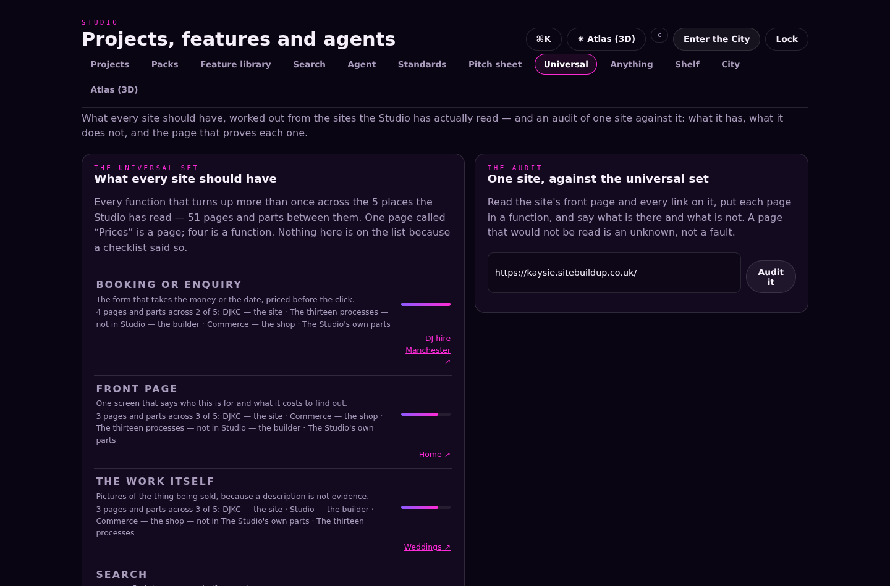
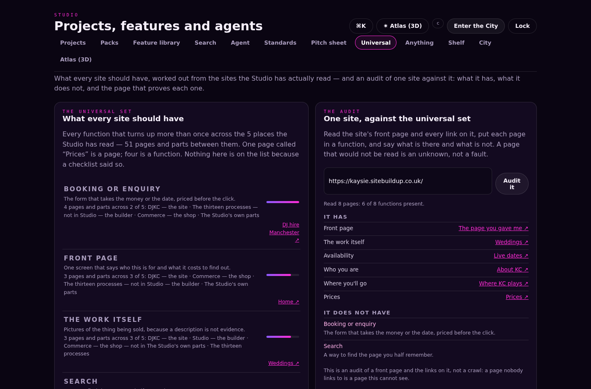

# What every site should have

*20 November 2026. The Studio's inventory, classified by function, turned into a
checklist — and a site read against it.*

## The question

Everything the Studio knows is a pile of artefacts: nine pages of DJKC, a
handful of Anything modules, sixteen parts of the Studio itself, thirteen
processes. The useful thing is not the pile. It is the *pattern* — which
functions keep appearing, which of them every site seems to need, and which one a
given site is missing.

## The rule

**A function is evidence, not opinion.** The checklist is built by classifying
the pages and parts that already exist and keeping the functions that turn up
more than once. One page called "Prices" is a page; four is a function. Nothing
is on the list because a best-practice article said so, and nothing is on it
because a designer liked it.

Pieces:

- **Fifteen functions**, each with a one-line reason — navigation, front page,
  the work, prices, availability, booking, questions, who you are, proof, where
  you'll go, writing, the small print, sign in, search, a map of the site.
- **`classifyPage(label, href)`** — scores a page's name and its address against
  each function's words and takes the best. The name is tried first because a
  page called "Prices" at `/p.html` is a price page, and the address says
  `prices`. Ambiguity resolves to the more specific word: *Weddings* is the work,
  *Book a wedding* is the booking. A fragment counts — `/#booking` is a booking
  link — a query string does not, because `?utm_source=` is about where a person
  came from, not about what a page is for.
- **`buildUniversal(sources)`** — counts each function in pages and parts, and
  in distinct sources, then keeps the ones with more than one. Sorted by how
  common they are. Each entry keeps a real example with a link, so the claim can
  be checked rather than trusted.
- **`auditSite(pages, universal)`** — a site's front page and the links on it,
  classified, against the list. Three outcomes, deliberately separate:
  **it has** (with the page that proves it), **it does not have**, and **I could
  not place** — a page nobody's vocabulary covers is an unknown, not a fault.

## The audit

`Universal` → the audit panel → paste a URL. It reads the front page and every
link on it through `POST /api/site` (the same reader the plates use), classifies
each, and prints the three lists. Sitebuildup, as read on the day: **front page,
the work, availability, who you are, where you'll go, prices** — and not
**booking or enquiry** or **search**, on the pages it links to. That is a
statement about *linked pages*, and the page says so: a booking form inside the
front page is not a page, and an audit of a front page is not a crawl.

## What is not in it, said out loud

The page says this rather than letting it be discovered: the GitHub repositories
and the Vercel projects are **not** in the evidence. The Studio reads repositories
only with a key and has no Vercel API at all, and a checklist built from what it
cannot see is a guess wearing a table. The Anything account *is* included when the
deployment has its key — and the page says when it does not.

## Files

- `studio/src/universal.ts` — functions, classifier, the universal set, the audit.
  Pure, and tested in `universal.test.ts` (17 tests).
- `studio/src/components/Universal.tsx` — the tab: evidence, checklist, audit.
- `studio/src/App.tsx` — the tab, and its blurb.

